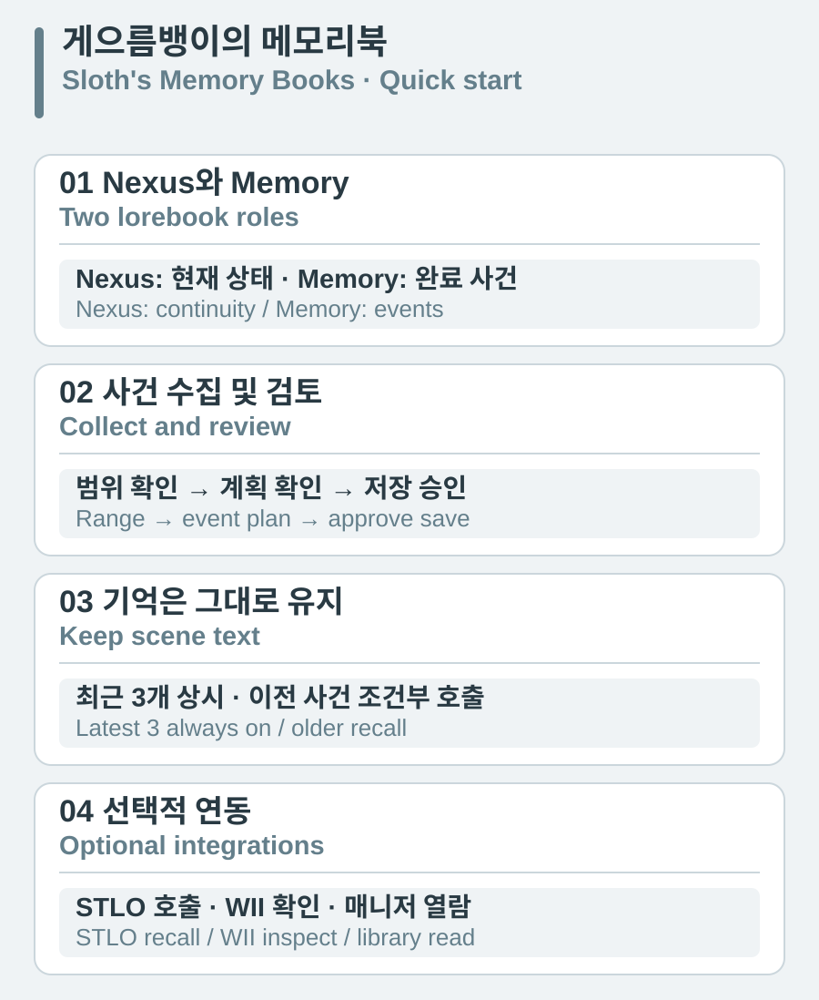
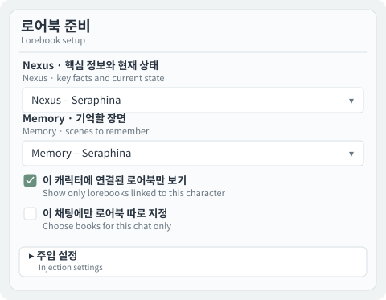
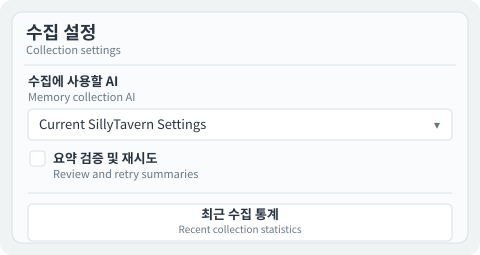
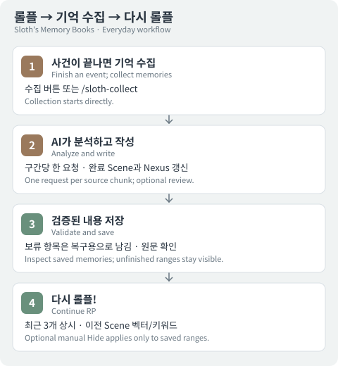

# 📚 Four Sloth extensions — one optional workflow

[한국어 안내 ↓](#한국어-안내)

> **Do I need all four? No!** Keep your existing books. Use the extensions you need.
>
> Set up once. Roleplay as usual!



## Who does what?

| Extension | Job |
| --- | --- |
| 🦥 [Memory Books](../readme.md) | Save memories |
| ⚖️ [STLO](https://github.com/AmbasaS2/SillyTavern-LorebookOrdering) | Manage budgets and optional Jev recall |
| 🔖 [WorldInfo Info](https://github.com/AmbasaS2/SillyTavern-WorldInfoInfo) | Verify actual insertion |
| 🦦 [Lorebook Manager](https://github.com/AmbasaS2/lore-manager) | Read, search, translate and edit stored lore |

## 📖 Set up once

### ① Install

Install each chosen extension from its repository. Back up chats, settings, lorebooks and translation data. Don't run a fork and upstream together.

### ② 🦥 Choose two memory books

Individual chat → Extensions → Memory Books → Sloth mode.



**Nexus:** who are we now? **Memory:** how did we get here?

Choose two distinct linked books → collection AI → older-Scene Vector or Keyword recall.



Try manual collection first.

<details>
<summary>Existing books, AUs and role options</summary>

No books yet? First successful collection can create them. Use chat-only assignments for separate AUs. Register verified previously summarized ranges for manual memories; old metadata alone is not proof of coverage. Core/Current Continuity default to Always on; Anchor (legacy LT) and NPC default to the existing detail mode, normally Vector. Existing Nexus injection changes must be applied explicitly. Set up native vectors when needed. Groups use Original Memory Books; tab and mode are distinct.

</details>

### ③ ⚖️ Set book budgets

**Extensions → Lorebook Budget Management → add books → priority and cap → save.**


Example: total World Info budget 8,000 tokens; Nexus priority 5/shared, world lore 4/shared, Memory 3/max 2,000. Enable Always-on protection if desired. A maximum is not a promise to fill it.

### ④ 🔮 Want Jev? (Optional)

NanoGPT subscription key → Billing → Subscription only. Save a Custom Chat Completion connection profile with:

```text
https://nano-gpt.com/api/subscription/v1
```

**Extensions → Lorebook Jev Recall → Use Jev → profile and total budget → save.**


Start with defaults. Jev chooses relevant saved lore; the RP model stays unchanged.

<details>
<summary>Candidate modes and experimental options</summary>

All eligible entries (default), native vector/keyword candidates, or Adaptive (experimental). Adaptive supplements native hits with memory cues above the estimated threshold (default 56,000), falling back to full when vectors/hits are unavailable. Partial injection (experimental, default off) may use eligible original-paragraph excerpts; full-text admission, budget and recursion remain. No refill from freed space and no guaranteed savings. World Info, per-book and Jev ceilings all apply. Jev budget is not an API input cap. Existing special activation rules remain. Retry or cancel on failure. Groups use per-book Jev. Direct Jev keys aren't supported.

</details>

### ⑤ 🔖 + 🦦 Open the library from the book

**Right-click the book / long-press on mobile → Link Lorebook Library.**


Click a verified entry to open the exact saved entry in the compatible library. Link off opens the built-in reader. Reading existing lore needs no AI.

## 🎮 Now go roleplay!

### ① Save today's memory

> “I will never make important decisions without you again.”

Finish the event → **Collect memories** (`/sloth-collect`).



Latest three eligible completed Scenes stay always-on; older managed Scenes rotate to Vector or Keywords. Stored text remains intact.

<details>
<summary>Collection and Hide</summary>

Normal collection has no plan approval popup. Default one request per source chunk; optional review can add one. Validated results save; unfinished/unverified source stays. Retained responses may be safely reused. Manual Hide is opt-in, only for verified saved ranges. Automatic collection does not auto-Hide. Hide does not delete chat.

</details>

### ② Later, the memory matters

> “Why did you hide it from me again?”

Jev ON can judge the promise's relevance without matching keywords. Jev OFF uses ordinary activation. Just send the RP message!

### ③ Did it really go in?

Tap the floating book.


Only verified inserted lore appears. Compatible Jev entries have 🔮.

Not there? Right-click/long-press → **View Lore Insight.**


- Inserted: confirmed items and reasons.
- Activated but not inserted: confirmed exclusions and reasons.
- Unconfirmed: count only. Unknown does not mean excluded.

See book/reason token estimates. Click terms/icons for explanations.

Curious what Jev selected? Open the compatible Chat Top Bar brain button or Lorebook Jev Recall → Advanced → Latest Jev recall.


AI selection → budget acceptance → activation → actual RP inclusion are different stages. Jev off? A recorded budget run can show the budget report.

<details>
<summary>If a memory is missing</summary>

Check book linkage, conditions, overall/book caps and Jev exclusions. Lore Insight covers activated entries; it does not list all inactive ones. /wi-report shows recorded keyword/recursion information for confirmed entries. Compatible STLO and WII share exact entry/tokenizer measurements and actual request evidence. Unknown is not zero. Verified pre-send inclusion does not guarantee the model uses it or prove provider-side processing.

</details>

### ④ Read the memory, beautifully

Click a verified title with library link on, or Extensions → Lorebook Manager.


Nexus: Card file or Character directory. Memory: Timeline, Continuous full text or Page-by-page. World lore: Encyclopedia. Search and read stored translations. Reading styles don't change recall or injection order. The reader shows current saved text, not a historical request snapshot.

Close it and go back to RP!

## 🧮 Which number should I look at?


| Question | Where |
| --- | --- |
| AI used for collection? | Memory Books → Recent collection statistics |
| Nexus stored size? | Memory Workshop → Memory overview |
| Jev use and full-text budget? | STLO → Jev search result / budget report |
| Confirmed RP insertion? | WorldInfo Info → Lore Insight |
| Saved content? | Lorebook Manager → library |

<details>
<summary>Costs, backup and compatibility</summary>

Collection/review/Side Prompts, AI maintenance, Jev and new AI translation/editing may send data to providers. Reading stored records and ordinary budget checks make no extra AI requests; native vectors may have separate usage. Reported usage, estimates and billing differ. Back up both books, chat, settings and manager translation data (user/files/). Original JSON ZIP is not a translation backup. Changing modes does not unhide messages; recovery is not a full backup.

Current guide basis: Memory Books 9.4.0-ambasa.7 ([d6c87d1](https://github.com/AmbasaS2/SillyTavern-MemoryBooks/commit/d6c87d1a0cbbdbc14ffcfda9d9e391cefd344687)), STLO 2.2.4-ambasa.7 ([0e9c286](https://github.com/AmbasaS2/SillyTavern-LorebookOrdering/commit/0e9c286767639f26e4556c99854ab48d9a544b22)), WorldInfo Info 1.7.1-ambasa.14 ([1d58bb1](https://github.com/AmbasaS2/SillyTavern-WorldInfoInfo/commit/1d58bb1f331418bf7d8b322123a76af9409f0214)), Lorebook Manager 1.4.85-ambasa.86 ([3242559](https://github.com/AmbasaS2/lore-manager/commit/3242559015e6e83392614a57e696adaff9ea9568)). Use a host supporting the structured World Info scan event; WII request verification is scoped to supported Chat Completion routes. Individual test records are in the repositories; this guide is not a claim of new joint testing on every device. All integrations are optional.

</details>

Illustrations are UI-based examples, not live screenshots. Every integration is optional.


---

## 한국어 안내

# 📚 실리태번 로어북 4종 연동 사용설명서

## 네 개 다 깔아야 하나요? 아니요! ✍️(◔◡◔)

필요한 것만 골라 쓰세요. 이미 만들어 둔 로어북도 그대로 쓰시면 됩니다.

**설정은 처음 한 번. 롤플은 평소처럼!**


## 🧩 네 확장, 각각 뭐 하는 애들인가요?

> **🦥 기억을 저장하는 애**
>
> [게으름뱅이의 메모리북 (Sloth's Memory Books)](https://github.com/AmbasaS2/SillyTavern-MemoryBooks)
>
> 사건이 끝나면 수집 버튼! 지나간 사건은 따로, 현재 상태도 따로 저장합니다.
>
> [GitHub 다운로드](https://github.com/AmbasaS2/SillyTavern-MemoryBooks)

> **⚖️ 필요한 기억을 골라 주는 애**
>
> [게으름뱅이를 위한 로어북 예산 관리기 (Lorebook Ordering for Sloths)](https://github.com/AmbasaS2/SillyTavern-LorebookOrdering)
>
> 로어북별 토큰 예산 관리. Jev를 켜면 지금 장면에 필요한 기억도 골라 줍니다.
>
> [GitHub 다운로드](https://github.com/AmbasaS2/SillyTavern-LorebookOrdering)

> **🔖 진짜 불러왔는지 확인해 주는 애**
>
> [게으름뱅이가 읽는 월드인포인포 (WorldInfo Info of Sloth)](https://github.com/AmbasaS2/SillyTavern-WorldInfoInfo)
>
> 책 버튼을 눌러 실제 주입된 로어 확인! 더 궁금하면 로어 인사이트.
>
> [GitHub 다운로드](https://github.com/AmbasaS2/SillyTavern-WorldInfoInfo)

> **🦦 기억을 예쁘게 읽게 해 주는 애**
>
> [로어북 매니저: 게으름뱅이 (Sloth the Lorebook Manager)](https://github.com/AmbasaS2/lore-manager)
>
> 저장한 로어를 서재에서 책처럼 읽습니다. 검색·번역·편집도 가능!
>
> [GitHub 다운로드](https://github.com/AmbasaS2/lore-manager)

## 🪄 그래서 나는 뭐부터 깔지?

> - 기억 수집만 귀찮다 → **메모리북**
> - 이미 로어북은 있다. 불러오는 게 문제다 → **STLO**
> - 이번에 뭐가 들어갔는지 궁금하다 → **월드인포인포**
> - 저장한 내용을 예쁘게 읽고 싶다 → **로어북 매니저**
>
> 전부 해당된다면… 네 개 다 쓰시면 됩니다! ㅎㅎ

## 📖 처음 한 번만 설정하기

## ① 확장 설치

> 실리태번 **확장 설치 → 위의 GitHub 주소 붙여넣기 → 설치 → 새로고침**

> 원본과 포크는 동시에 켜지 마세요. 교체하기 전에 채팅·설정·로어북·번역 파일을 백업해 주세요. 설치 순서는 자유입니다.

## ② 🦥 메모리북: 기억을 저장할 두 권 고르기

> 1:1 캐릭터 채팅 → 확장 메뉴 → 메모리 북 → **For 게으름뱅이** 모드


> **🧭 Nexus = 지금 우리는 어떤 사이인가?**
>
> 핵심 설정, 관계, 현재 상태, 장기 기억, NPC를 정리하는 책.

> **📕 Memory = 우리가 여기까지 어떻게 왔는가?**
>
> 처음 만난 날, 싸운 날, 화해한 날… 지나간 사건을 각각 기록하는 책.

오늘 화해했다고 어제 싸운 일이 없어지는 건 아니잖아요?

> - [ ] 서로 다른 두 권 지정 (책 이름은 자유!)
> - [ ] 수집에 사용할 AI 선택
> - [ ] 이전 Scene의 호출 방식: 벡터 또는 키워드 선택


**여기까지면 됩니다!** 첫 수집은 자동 수집을 끄고 직접 해 보세요.

<details>
<summary>💡 기존 로어북이나 여러 AU를 쓰는 분만</summary>

- 책이 없다면 첫 수집 저장 시 생성할 수 있습니다. 한 권만 있으면 부족한 책을 만드세요.
- 같은 캐릭터의 여러 AU는 이 채팅에만 로어북 따로 지정.
- 기존 수동 요약을 이어받을 때는 기억 정비소 → 기존 요약 범위 등록에서 이미 저장한 원문 범위만 등록합니다.
- Nexus의 Core Memory·Current Continuity는 기본 상시, Anchor(기존 LT)·NPC는 기존 상세 방식(보통 벡터). 주입 설정에서 각각 선택할 수 있어요. 기존 항목의 변경은 정비소에서 직접 적용합니다.
- 벡터는 실리태번 벡터 저장소 설정이 필요합니다.
- 모드와 탭은 별개이며 그룹 채팅은 기존 메모리북 모드를 사용합니다.

</details>

자세한 설정: [게으름뱅이의 메모리북 (Sloth's Memory Books)](https://github.com/AmbasaS2/SillyTavern-MemoryBooks)

---

## ③ ⚖️ STLO: 로어북마다 예산 정하기

> 확장 메뉴 → **로어북 예산 관리** → 책 추가 → 우선순위·예산 설정 → 저장


> **예를 들어 전체 로어북 예산이 8,000토큰이라면?**
>
> - Nexus · 우선순위 5 / 전체 예산 공유
> - 세계관 · 우선순위 4 / 전체 예산 공유
> - Memory · 우선순위 3 / 최대 2,000토큰
>
> 중요한 책부터 고려하도록 정해 줍니다.
>
> 2,000토큰은 최대치이지 꼭 2,000토큰을 넣겠다는 뜻은 아니에요.

**🔵 파란불부터 보호하고 싶다면?**  
상시 주입 우선 보호를 켜 주세요. 그래도 전체 예산은 지켜야 합니다!

## ④ 🔮 Jev도 쓰고 싶다면? (안 쓰시면 패스!)

> **나노GPT 연결 프로필 만들기**
>
> - 나노GPT 구독 키 → Billing → Subscription only
> - 실리태번 Chat Completion → Custom
> - 아래 주소로 연결 프로필 저장
>
> ```txt
> https://nano-gpt.com/api/subscription/v1
> ```
>
> 확장 메뉴 → **로어북 Jev 호출 → Jev 사용 → 프로필·총예산 선택 → 저장**


**일단 기본값으로 써 보세요!**  
Jev는 이미 저장된 기억 중 이번 장면에 필요한 것을 고르는 AI입니다. 롤플 모델은 그대로예요.

<details>
<summary>💡 판정 방식이나 예산을 더 만지고 싶을 때만</summary>

- 전체 로어북 항목: 기본값. 적격 기억 전체 판단.
- 벡터·키워드 검색 후보: 기존 검색에 잡힌 것만 판단.
- 적응형(실험): 전체 판단 예상 입력이 기준(기본 56,000 추정 토큰)을 넘을 때 기존 검색에 장기 기억·짧은 기록·역할·제목/키워드·최근 출처 단서를 보강. 벡터 회수 불가/적격 결과 없음이면 전체 판단으로 돌아갑니다.
- 부분 주입(실험): 기본 꺼짐. 적격 긴 Scene의 원문을 발췌할 수 있으나 전문 기준 발동·재귀·예산은 그대로이고 남는 공간을 다른 기억으로 채우지 않습니다. 품질·절약 보장은 없어요.

**예산 세 가지**  
실리태번 전체 월드 인포 예산, 책별 예산, Jev 총예산을 모두 지킵니다. Jev 총예산은 API 입력 상한이 아니에요.

파란불·Sticky·Outlet 등 특수 규칙은 기존대로. 실패하면 재시도 또는 답변 취소. 그룹은 책별 Jev 설정을 사용합니다.

직접 Jev 키는 지원하지 않고 나노GPT 구독 전용 경로를 사용합니다.

</details>

자세한 설정: [게으름뱅이를 위한 로어북 예산 관리기 (Lorebook Ordering for Sloths)](https://github.com/AmbasaS2/SillyTavern-LorebookOrdering)

---

## ⑤ 🔖 + 🦦 책 버튼에서 서재로 바로 이동하기 (선택)

> 월드인포인포 책 버튼 **PC 우클릭 / 모바일 꾹 누르기 → 로어북 서가 연동 체크**


이제 주입된 로어의 제목을 누르면 호환 로어북 매니저에서 해당 항목이 열립니다. 연동을 끄면 기본 열람창이 열려요.

> 서재만 쓰고 싶으신 분은 로어북 매니저의 화면·고급 설정에서 실리태번 기본 화면을 선택하시면 됩니다.
>
> 두 확장의 열람 기능은 별도 AI 연결 없이 쓸 수 있어요.

자세한 설정: [게으름뱅이가 읽는 월드인포인포 (WorldInfo Info of Sloth)](https://github.com/AmbasaS2/SillyTavern-WorldInfoInfo) · [로어북 매니저: 게으름뱅이 (Sloth the Lorebook Manager)](https://github.com/AmbasaS2/lore-manager)

---

## 이제 준비 끝. 이제 노세요! (ง •̀\_•́)ง

평소에는 확장 네 개를 돌아가면서 설정하지 않아도 됩니다.

## 🎮 평소 롤플할 때는 이렇게!

## ① 오늘 있었던 일은 메모리북에 저장

> 두 사람이 크게 다퉜다가 화해했습니다.
>
> “다시는 중요한 결정을 혼자 내리지 않을게.”

사건이 끝났다면 **기억 수집** 버튼을 누르세요. 끝!


- 최근 완료 Scene 3개는 🔵 상시.
- 이전 Scene은 키워드 또는 벡터.
- 과거 사건 본문은 그대로 보존.

<details>
<summary>💡 수집할 때 알아두면 좋은 것</summary>

일반 수집은 계획 승인 팝업 없이 검증된 결과를 저장합니다. 기본 구간당 한 요청, 선택 검증은 추가 요청이 발생할 수 있어요. 진행 중·검증되지 않은 원문은 남겨 둡니다. 보류 응답은 조건이 맞으면 검토·재사용할 수 있습니다.

수동 Hide는 고급 설정에서 켜야 합니다(기본 꺼짐). 저장 확인된 범위만 숨기며, 채팅 삭제가 아닙니다. 자동 수집은 자동으로 Hide하지 않아요.

</details>

---

## ② 한참 뒤, 예전 기억이 필요한 순간이 오면?

> 캐릭터가 또 혼자 일을 해결하려고 합니다.
>
> “왜 또 나한테 숨겼어?”

예전 약속의 키워드가 하나도 없다면?

> **Jev ON 🔮**  
지금 상황에 그 약속이 필요한지 판단합니다.
>
> **Jev OFF**  
기존 키워드·벡터·상시 호출을 사용합니다.

둘 다 그냥 평소처럼 채팅을 보내시면 됩니다. 따로 기억을 호출할 필요는 없어요.

---

## ③ 그 기억이 진짜 들어왔는지 확인!

**일단 떠 있는 책 버튼을 누르세요.**


책에는 **실제 주입 확인된 로어만** 뜹니다. Jev로 불러온 기억에는 🔮가 붙어요.

> **아니, 분명 저장했는데 왜 안 보이지?**
>
> 책 버튼 우클릭(모바일 꾹 누르기) → **로어 인사이트 보기**


- 주입된 로어: 실제 요청에 들어간 항목과 이유
- 발동했지만 주입되지 않은 로어: 확인된 제외 항목과 이유
- 주입 미확인: 개수로 표시 (미확인은 미주입이 아닙니다!)

책별·발동 방식별 토큰도 확인할 수 있어요. 짧은 용어나 아이콘은 눌러 보면 설명이 펼쳐집니다.

> **Jev가 뭘 골랐는지도 궁금하다면?**
>
> 호환 챗탑바의 두뇌 버튼 또는 로어북 Jev 호출 → 고급 설정 → 최근 Jev 실행


**AI 선택 → 예산 통과 → 최종 발동 → 실제 RP 포함**을 따로 확인할 수 있습니다. Jev 없이 예산만 쓰는 분도 기록이 있으면 예산 보고서를 열 수 있어요.

<details>
<summary>🔎 기억이 안 들어왔을 때 체크</summary>

- 현재 채팅에 책이 연결됐나요?
- 로어가 활성화되어 있고 조건에 맞나요?
- 전체/책별 예산에서 밀렸나요?
- Jev 대상에서 제외하지 않았나요?

로어 인사이트는 발동된 항목을 중심으로 확인합니다. 처음부터 발동하지 않은 항목의 개별 목록은 제공하지 않아요. /wi-report는 확인된 주입 항목의 키워드·재귀 기록입니다.

호환 STLO와 월드인포인포는 실제 요청 근거와 같은 본문·토크나이저의 개별 토큰 계측을 공유합니다. 확인되지 않은 값은 0이 아니며, 실제 주입되어도 모델이 반드시 활용한다는 보장은 없습니다.

</details>

---

## ④ 궁금한 기억은 예쁘게 읽기!

로어 제목을 눌러 서재로 이동하거나 확장 메뉴 → **로어북 매니저**.


> - 🧭 Nexus: 카드파일이나 인물록
> - 📕 Memory: 타임라인 / 연속 기록장 / 페이지 넘김
> - 🌍 세계관: 백과사전
>
> 취향대로 골라 읽으세요!

저장 번역을 읽거나 돋보기로 원하는 내용을 검색할 수 있습니다. 읽는 방식은 실제 발동이나 주입 순서를 바꾸지 않아요.

다 읽었으면 닫고 다시 롤플! 사건이 끝나면 ①부터 반복하시면 됩니다.

---

## 🧮 숫자가 궁금해졌을 때만 보세요!


> **수집에 AI를 얼마나 썼지?**  
메모리북 → 수집 설정 → 최근 수집 통계
>
> **Nexus가 너무 커졌나?**  
메모리북 → 기억 정비소 → 기억 현황

> **Jev가 얼마나 읽고 예산을 썼지?**  
STLO → Jev 검색 결과 / 예산 보고서

> **이번 RP에 진짜 얼마나 들어갔지?**  
월드인포인포 → 로어 인사이트

로어북 매니저의 토큰 통계는 저장한 책의 분량입니다. **저장량, 수집 사용량, 전문 예산, 실제 주입량은 서로 다른 숫자**예요!

<details>
<summary>💡 비용·백업·호환성 (필요할 때 열어 주세요)</summary>

**AI 요청이 발생하는 기능**

- 메모리북 수집·검증·사이드 프롬프트·AI 기억 정리/사건 정비
- STLO의 선택형 Jev
- 새 AI 번역·AI 수정

기본 예산 관리, 수집 통계·기억 현황 열람, 월드인포인포, 서재·저장 번역 열람은 별도 AI 요청 없이 쓸 수 있습니다. 기존 벡터 제공자 사용량은 별도일 수 있어요. AI에 대화/로어가 전달될 수 있으며 보고값·추정값·실제 청구액은 구분합니다.

**백업**

두 기억 책, 채팅, 설정, 번역 기록(user/files/)을 보존하세요. 원본 로어북 ZIP과 번역 포함 백업은 별개입니다. 숨긴 메시지는 모드를 바꿔도 자동 복원되지 않으며 복구 기록은 전체 백업을 대신하지 않습니다.

**안내 기준**

메모리북 9.4.0-ambasa.7 / STLO 2.2.4-ambasa.7 / 월드인포인포 1.7.1-ambasa.14 / 로어북 매니저 1.4.85-ambasa.86. 지원되는 Chat Completion 요청과 구조화된 월드 인포 스캔 기준이며 모든 환경·모델의 결과를 보장하지 않습니다.

[GitHub 한영 연동 가이드와 기준 커밋](https://github.com/AmbasaS2/SillyTavern-MemoryBooks/blob/main/docs/four-extensions-guide.md)

</details>

#### 📋 원작 및 라이선스

각 확장의 안내글과 GitHub README를 참고하세요. 모든 연동은 선택입니다. 안내 그림은 예시 데이터로 만든 UI 목업이며 테마·화면 크기에 따라 다를 수 있어요.
