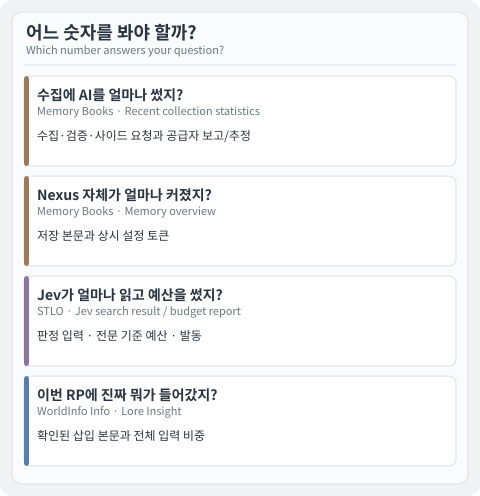

# 📚 Four Sloth extensions — one optional workflow

[한국어 안내 ↓](#한국어-안내)

> **Do I need all four? No!** Use the ones you like. Existing lorebooks can stay as they are. You do not have to recreate your memories.

## 🧩 What each extension does

| Extension | Role |
| --- | --- |
| 🦥 [Sloth's Memory Books](../readme.md) | Save completed events and maintain Nexus; inspect collection usage and existing memories. |
| ⚖️ [Lorebook Ordering for Sloths](https://github.com/AmbasaS2/SillyTavern-LorebookOrdering) | Set per-book priority and budgets; optionally use Jev to select existing lore. |
| 🔖 [WorldInfo Info of Sloth](https://github.com/AmbasaS2/SillyTavern-WorldInfoInfo) | The book lists verified insertions; Lore Insight analyzes activated entries and observed omissions. |
| 🦦 [Sloth the Lorebook Manager](https://github.com/AmbasaS2/lore-manager) | Read/search/edit stored lore and translations in a separate library. |

## ⚡ Set up once — only the extensions you install

1. Back up chats, lorebooks, settings and separate translation files; install each fork from its repository in SillyTavern Extensions → Install extension. Do not run an upstream extension and its fork together. There is no required installation order.
2. In a one-to-one chat select Sloth mode in Memory Books. Assign distinct linked Nexus and Memory books (names are your choice); if none exist, first successful collection can create them. For distinct AUs choose chat-only books and verify the actual ST links. Group chat uses Original Memory Books.
3. Choose a collection AI profile. Core Memory and Current Continuity default to always-on; Anchor (legacy LT) and NPC default to the existing detail recall mode, usually vector. Choose older Scene vector/keyword recall; configure native Vector Storage if using vectors. New Nexus entry settings do not silently rewrite existing records. For hand-authored memories, register only verified previously summarized chat ranges in Memory Workshop; old metadata alone is not a collection receipt or rotation proof.
4. STLO: add the books, set priorities (1–5) and caps, optionally protect constants. Example only: Nexus priority 5, world lore 4, Memory 3 capped at 2,000 within an overall 8,000-token budget. Caps are maxima, not guaranteed reservations; always-on still needs room.
5. Optional Jev: use a NanoGPT subscription-only key and a saved Custom Chat Completion profile with base URL `https://nano-gpt.com/api/subscription/v1`. Enable Jev in the current character's Lorebook Jev Recall, select profile and total budget, save. Default all-eligible mode can work without ordinary vector retrieval. Filtered mode only assesses native hits; Adaptive (experimental, 56,000 estimated input threshold by default) adds eligible memory cues above the threshold and falls back to full when vectors/hits are unavailable. Partial injection is experimental and off by default: it can use verified original paragraphs for eligible structured long Scenes; full-text budget and activation stay unchanged. No guarantee of recall or savings. Direct Jev keys are not supported by this fork.
6. Optional library link: right-click/long-press the WorldInfo Info book → Link Lorebook Library. A verified entry opens by book name and UID in the compatible manager; otherwise use the built-in reader. Read/search/saved translations do not require AI.

## 🎮 Everyday RP

An old promise: “I will never make important decisions without you again.”

Finish the event → **Collect memories** (or `/sloth-collect`). The default collector analyzes and writes in one request per source chunk; validated results save directly, with no plan approval popup. Unfinished or rejected ranges stay available. Review saved content. The latest three eligible completed Scenes stay always-on, older managed Scenes rotate to vector/keywords while retaining text. Manual Hide is opt-in (off by default), only for verified saved ranges; automatic collection does not Hide automatically.

Later: “Why did you hide it from me again?”

With Jev on, the prior promise may be selected even without matching words. With Jev off, native activation remains. Selection must still pass budgets and native activation, and activation is not proof of actual insertion. STLO applies the shared World Info cap, book cap and shared Jev cap together.

Open STLO → Lorebook Jev Recall → Advanced Jev settings → Latest Jev recall (or the compatible Chat Top Bar brain icon). The search result shows candidate/assessment/selection/budget/activation stages, budget use, AI search usage, and RP evidence if a compatible viewer supplies it. With Jev off, a budget-only report is available after a recorded budget run.

Then open the WorldInfo Info book. It shows only verified insertion in the correlated pre-send Chat Completion request. Right-click/long-press → **View Lore Insight**: verified inserted entries and verified omitted activations, recorded reasons, per-book/reason/entry token estimates, share of collected input, and unverified insertion **count only**. Not-activated entries are not individually listed in the current version. Unknown is not excluded. Click a term/icon for details. A compatible STLO/WII pair shares exact individual measurement and verified RP evidence, without another Jev call. Unsupported routes and later/provider transformations remain outside proof. Reading a stored entry (including an available translation) is not a historical request snapshot; partial injection may have sent less.

Read the memory in the manager (optionally via the library link). Choose Card file or People for Nexus and Memory view for completed Scenes: Timeline / Continuous full text / Page-by-page. Search and saved translations are read-only; new AI translation/editing is optional. Reading styles and sorting do not change actual recall.

## 🧮 Which report answers which question?

- **Memory Books → Collection settings → Recent collection statistics:** up to 30 local attempts, provider-reported or estimated collection/review/Side Prompt usage, result and recovery. Clearing stats does not delete memories.
- **Memory Workshop → Memory overview:** selected Nexus stored tokens and always-on flags, not actual injection. AI cleanup is separate and consent-based.
- **STLO → Jev search result / budget report:** search usage, full-text budget, activation/trim. Verified RP metrics refer to the measured Jev subset, not all lore.
- **WorldInfo Info → Lore Insight:** verified inserted lore and approximate share of observed request text. Missing measurements are not zero. The model is not guaranteed to use the included information.

## 💡 Costs, backups and compatibility

Collection/review/Side Prompts, optional Jev and new AI translation/editing can send content to a provider. Ordinary budget management, inspection and reading saved translations do not make extra AI calls; existing vector services may have their own usage. Provider usage, host estimates and actual bills are different. Back up both books and separate translation data (`data/<user>/user/files/`, including manager translation JSON and index); original lorebook ZIP export is not a translation backup. Existing collection recovery is not a substitute for a full backup.

Current guide basis: Memory Books 9.4.0-ambasa.7 ([d6c87d1](https://github.com/AmbasaS2/SillyTavern-MemoryBooks/commit/d6c87d1a0cbbdbc14ffcfda9d9e391cefd344687)), STLO 2.2.4-ambasa.7 ([0e9c286](https://github.com/AmbasaS2/SillyTavern-LorebookOrdering/commit/0e9c286767639f26e4556c99854ab48d9a544b22)), WorldInfo Info 1.7.1-ambasa.14 ([1d58bb1](https://github.com/AmbasaS2/SillyTavern-WorldInfoInfo/commit/1d58bb1f331418bf7d8b322123a76af9409f0214)), Lorebook Manager 1.4.85-ambasa.86 ([3242559](https://github.com/AmbasaS2/lore-manager/commit/3242559015e6e83392614a57e696adaff9ea9568)). Use a host supporting the structured World Info scan event; WII request verification is scoped to supported Chat Completion routes. Individual test records are in the repositories; this guide is not a claim of new joint testing on every device. All integrations are optional.

---

## 한국어 안내

# 📚 실리태번 로어북 4종 연동 사용설명서

> **네 개 다 깔아야 하나요? 아니요!** 마음에 드는 것만 설치하시면 됩니다. 이미 열심히 정리한 로어북도 그대로 쓰세요. 기억을 처음부터 다시 만들 필요 없어요!

## 🧩 네 확장이 각각 하는 일

- 🦥 **[게으름뱅이의 메모리북](../readme.md)** — 지난 사건은 Memory, 핵심 정보와 현재 상태는 Nexus에 저장. 기억 정비소와 수집 통계도 제공합니다.
- ⚖️ **[게으름뱅이를 위한 로어북 예산 관리기](https://github.com/AmbasaS2/SillyTavern-LorebookOrdering)** — 책별 우선순위·예산 관리, 선택형 Jev로 필요한 기존 기억 호출.
- 🔖 **[게으름뱅이가 읽는 월드인포인포](https://github.com/AmbasaS2/SillyTavern-WorldInfoInfo)** — 책 버튼은 실제 주입 확인, 로어 인사이트는 발동한 항목의 확인·제외와 기록된 이유 분석.
- 🦦 **[로어북 매니저: 게으름뱅이](https://github.com/AmbasaS2/lore-manager)** — 기억을 책처럼 읽고 검색·번역·편집·백업.

## 이 조합, 누가 쓰면 좋을까? ✍️(◔◡◔)

- 예전에 있었던 일을 캐릭터보다 내가 더 잘 기억해서 슬픈 사람
- 기억을 쓰고 싶지만 구간마다 직접 요약하는 게 귀찮은 사람
- 저장한 기억이 정작 필요한 순간에 안 들어와 화나는 사람
- 어느 로어가 얼마나 들어갔는지 궁금하고, 쌓아 온 서사를 예쁘게 읽고 싶은 사람

## ⚡ 간단 사용 설명

처음 한 번: 메모리북에 두 권과 수집 AI 지정 → STLO에 우선순위·예산 지정 (Jev 선택) → 월드인포인포와 매니저의 서가 연동 선택.

평소에는: 롤플 → 사건이 끝나면 기억 수집 → 저장 확인 → 다시 놀기 → 책 버튼에서 실제 주입 확인 → 궁금한 기억 누르기!

## 📖 사용 설명서 — 처음 한 번

### ① 필요한 확장 설치

각 저장소의 GitHub 주소를 실리태번 확장 설치 메뉴에 붙여넣고 설치·새로고침. 순서는 자유입니다. 기존 원본과 해당 포크를 동시에 켜지 말고 채팅·로어북·설정·번역 기록부터 백업하세요.

### ② 기억을 저장할 두 권과 수집 AI 정하기

1:1 캐릭터 채팅 → 확장 메뉴 → 메모리 북 → **사용 모드 (현재 캐릭터) → For 게으름뱅이**. 그룹은 기존 메모리북 모드입니다. 탭 변경은 설정 화면만 바꿉니다.

- Nexus: Core Memory(핵심 장기 기억), Current Continuity(현재 상태), Anchor(앵커, 기존 LT), NPC. 역할별 상시·벡터·키워드·미주입을 선택할 수 있고, 기본은 코어/현재 상태 상시, 앵커/NPC는 기존 상세 방식(보통 벡터).
- Memory: 완료 사건을 각각 저장. 관리되는 최신 Scene 3개는 상시, 이전 Scene은 벡터 또는 키워드. 본문은 그대로.

연결된 서로 다른 두 책 지정 → 수집 AI 지정 → 주입 설정 확인. 책 이름은 자유이고 연결된 책이 없으면 첫 수집 저장 시 생성할 수 있습니다. 여러 AU는 이 채팅에만 책을 따로 지정하고 실제 ST 연결도 확인하세요. 기존 수동 요약을 이어받을 때에는 기억 정비소의 **기존 요약 범위 등록**에서 이미 저장된 원문 범위만 확인·등록합니다. 옛 메타데이터만으로 수집 완료나 최근 3개 회전이 보장되지는 않아요. 첫 수집은 자동 수집을 꺼 두고 사본에서 시험하면 좋아요.

### ③ 예산 정하기 (Jev는 선택!)

전체 월드 인포 예산이 8,000이라면 예를 들어 Nexus 우선순위 5, 세계관 4, Memory 3/최대 2,000. 최대치는 반드시 채워 주겠다는 약속이 아닙니다. 상시 주입 우선 보호를 켜도 세 예산을 무시하지 않아요.

Jev를 쓰고 싶다면 나노GPT 구독 키 Billing → Subscription only. 실리태번 Chat Completion → Custom 연결 프로필에 `https://nano-gpt.com/api/subscription/v1` 저장 → 로어북 Jev 호출 → 현재 캐릭터 Jev 사용 → 프로필·총예산 지정 → 저장.

**어떤 로어를 보여 줄까요?** 전체 로어북 항목(기본) / 벡터·키워드 검색 후보 / 적응형(실험). 적응형은 예상 전체 입력량 기준(기본 56,000 추정 토큰)에 따라 기억 단서로 검색 후보를 보강하고 벡터 회수 불가·적격 결과 없음이면 전체 판단으로 돌아갑니다. 부분 주입(실험)은 고급 설정에서 별도 선택하며 기본 꺼짐입니다. 적격 긴 Scene의 원문 문단 발췌만 가능하고 전문 기준 예산·발동·재귀를 유지합니다. 남은 공간을 다른 기억으로 채우지 않고 절약을 보장하지도 않습니다. 처음엔 기본값 그대로도 충분해요!

Jev 총예산은 API 입력 상한이 아닙니다. 전체 월드 인포·책별·Jev 한도를 함께 적용합니다. 그룹 채팅은 책별 Jev 설정을 따릅니다. 실패하면 재시도 또는 답변 취소.

### ④ 확인하고 서재에서 읽기

월드인포인포의 책 버튼을 우클릭(모바일 꾹 누르기) → **로어북 서가 연동**을 원할 때 체크. 호환 매니저에서 책 이름·UID로 해당 항목을 엽니다. 연동 없이 기본 열람창을 쓸 수도 있고, 독립 서재만 쓸 수도 있어요. 별도 AI 연결은 읽기에 필요 없습니다.

## 🎮 이제 롤플! 평소에 쓰는 순서

### ① 사건이 끝나면 기억 수집

“다시는 중요한 결정을 혼자 내리지 않을게.”

수집 아이콘/기억 수집 버튼 또는 `/sloth-collect` → AI가 미수집 원문을 분석·작성 → 검증된 Scene과 Nexus 변경 바로 저장 → 결과 확인 → 다시 놀기!

별도 계획 승인 팝업은 없습니다. 기본 수집은 구간당 한 요청이며 긴 대화는 구간을 나눌 수 있어요. 진행 중·검증되지 않은 구간은 남겨 둡니다. 정상 저장된 기억만 선택적 수동 Hide가 가능하고 기본 꺼짐, 자동 수집은 자동 Hide하지 않습니다. Hide는 원문 삭제가 아니에요.

### ② 한참 뒤 그 기억이 필요해지면

“왜 또 나한테 숨겼어?”

Jev ON이면 정확한 키워드가 없어도 예전 약속을 필요로 하는 장면인지 판단할 수 있습니다. OFF이면 기존 상시·키워드·벡터 호출을 사용해요. 저장 → 판정 → 예산 통과 → 실제 발동 → 실제 주입은 다른 단계입니다. 어느 하나도 다음 단계를 무조건 보장하지 않습니다.

### ③ 정말 들어갔을까?

- STLO: 로어북 Jev 호출 → Jev 고급 설정 → 최근 Jev 실행, 또는 호환 챗탑바 두뇌 버튼. 최신 **Jev 검색 결과**에서 검색 완료·AI 선택·예산 통과·최종 발동, Jev 예산 사용량, 검색에 사용한 AI, RP 프롬프트 포함 여부를 구분합니다. Jev OFF라도 예산 검사 기록이 있으면 예산 보고서를 확인할 수 있어요.
- 월드인포인포의 **책 버튼:** 전송 직전 요청의 실제 주입 확인 로어만. 호환 STLO의 확인된 Jev 항목은 🔮.
- **로어 인사이트:** 주입된 로어 / 발동했지만 주입되지 않은 것이 확인된 로어를 펼쳐 보고, 발동·제외 이유와 항목별 토큰, 책별·발동 방식별 토큰, 입력 비중을 확인합니다. 주입 여부 미확인은 개수만 표시하고 미발동 항목은 개별 목록에 넣지 않아요. 밑줄 용어나 발동 아이콘을 누르면 설명이 펼쳐집니다.
- 호환 STLO와 월드인포인포는 동일한 개별 토큰 계측과 실제 요청 근거를 공유합니다. 근거가 없으면 미확인·미계측이지 0이나 제외가 아닙니다.

책이 제대로 연결됐는지, 항목의 발동 조건, 전체·책별 예산, Jev 제외 여부를 확인하세요. /wi-report는 주입 확인 로어의 기록된 키워드·재귀 보고서입니다. 주입 확인이 곧 모델이 답변에 활용했다는 보장은 아니에요.

### ④ 궁금한 기억 눌러서 읽기 (예쁘게!)

Nexus는 카드파일·인물록, Memory는 메모리 보기(타임라인·연속 기록장·페이지 넘김), 세계관은 백과사전으로 읽어 보세요. 돋보기로 원문·저장 번역을 검색하고, 필요하면 새 번역을 선택합니다. 읽기 방식과 서재 정렬은 실제 주입 조건이나 순서를 바꾸지 않아요. 열람창은 현재 저장된 본문이며 실제 요청의 스냅샷은 아닙니다.

## 💡 어느 토큰 숫자를 봐야 할까?

| 궁금한 것 | 열어 볼 곳 |
| --- | --- |
| 수집 AI 사용량·비용·저장 결과 | 메모리북 → 수집 설정 → 최근 수집 통계 (브라우저 최근 30개 시도) |
| Nexus 저장량·상시 설정·중복 문단 | 메모리북 → 기억 정비소 → 기억 현황 (읽기 전용) |
| Jev 입력·전문 예산·발동/탈락 | STLO → 최근 Jev 실행 / 예산 보고서 |
| 이번 RP에 실제 들어간 로어·비중 | 월드인포인포 → 로어 인사이트 |
| 저장한 원문·번역·기억 자체 | 로어북 매니저 → 독립 서재 |

AI 요청은 수집·검증·사이드 프롬프트·AI 기억 분석, 선택적 Jev, 새 AI 번역/수정 시 발생합니다. 기존 벡터 제공자의 사용량은 별도일 수 있어요. 공급자 보고값과 호스트 추정치 및 청구액은 구분합니다. 원본 JSON ZIP 내보내기와 번역 포함 백업도 별개! 메모리북 두 권, 설정, 채팅 및 매니저 번역 기록(`user/files/`)을 보존하세요.

안내 기준: 메모리북 9.4.0-ambasa.7, STLO 2.2.4-ambasa.7, 월드인포인포 1.7.1-ambasa.14, 로어북 매니저 1.4.85-ambasa.86 (위 영문 기준 커밋 참조). 개별 원작·라이선스·상세 설정·검증 범위는 각 확장 README 참고. 모든 연동은 선택이고 모든 환경에서의 동작·모델 기억 활용을 보장하지 않습니다.
