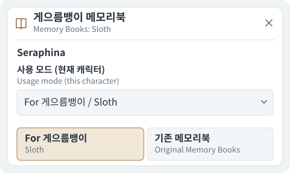
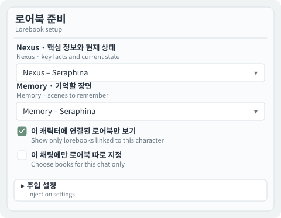

<!--
Copyright (C) 2024–2026 Aiko Hanasaki
SPDX-License-Identifier: AGPL-3.0-only
-->

# 📕 Memory Books: Sloth

Based on [Memory Books by Aiko Hanasaki](https://github.com/aikohanasaki/SillyTavern-MemoryBooks). This fork integrates my Sloth (게으름뱅이) memory workflow into Memory Books while retaining the original tools in a separate tab. **Usage mode is selected per character; tabs only switch the settings view.**

[한국어 안내 ↓](#-게으름뱅이-메모리북) · [Original Memory Books](https://github.com/aikohanasaki/SillyTavern-MemoryBooks) · [Original feature guides](./Start_Here.md)

## 📥 Installation

1. Back up your chats, settings and lorebooks, especially when switching from the original Memory Books.
2. In SillyTavern's extension installer, enter:

   ```
   https://github.com/AmbasaS2/SillyTavern-MemoryBooks
   ```

## Who is this for?

- Preserve individual completed scenes without repeatedly compressing them into a single history summary.
- Separate ongoing continuity and key facts (Nexus) from completed events (Memory).
- Automatically identify completed events from unsaved chat, approve the plan, and optionally hide successfully collected messages.
- Keep the latest three completed scenes always on, convert older scenes to keyword or vector recall, and retain their full text.
- Collect manually or at a token/message interval, use different books for different chats with the same character, and keep the RP model unchanged.
- Generate separate Side Prompts such as diaries; review merge, split, or shortening operations on stored scenes; or select the original Memory Books workflow per character.

If you prefer the original manual or consolidation workflow, select **Original Memory Books** in the character's Usage mode, then use its settings tab. Group chats use Original mode.

## ⚡ Quick start

**Current version: 9.4.0-ambasa.3.**

> **Roleplay → finish an event → collect memories → approve → continue RP.**
>
> Nexus keeps ongoing continuity; Memory keeps completed events. Sloth saves lore and SillyTavern recalls it. The original mode remains selectable per character; tabs only change the settings view.

**Set up once**

1. Install one Memory Books version only. In a one-to-one chat open Extensions → Memory Books → Usage mode → Sloth (default). Group chats use Original mode.
2. Assign distinct Nexus and Memory books or create them on approved first collection if no books are linked. Use chat-only assignments for different AU histories.
3. Select a collection AI profile and Keyword or Vector for older scenes. Leave automatic collection off for your first try. Vector requires native vector setup.

**During everyday RP**

1. Finish an event → click **Collect memories** or use `/sloth-collect`.
2. Confirm the range and approve the plan. The AI writes, validates and saves the memories.
3. Inspect the saved memories in World Info or Lorebook Manager. Hide is optional and applies only to successfully saved ranges.
4. Continue RP. The latest three completed scenes stay always-on; older scenes switch recall mode without losing their text.

## 📖 How to use

> The bilingual illustrations are simplified UI mock-ups based on the extension controls in SillyTavern, not screenshots. Values and lorebooks are illustrative examples.

### 1. Set up Memory Books: Sloth once

1. Reload and open a one-to-one character chat.
2. Extensions → **Memory Books: Sloth**.
3. Check **Usage mode (this character) → For 게으름뱅이 🦥** (default), then open the Sloth settings tab.

> [!IMPORTANT]
> Run only one Memory Books installation at a time.

**The mode selector controls what runs; the two tabs only change the visible settings.** Switching mode keeps existing settings, lorebooks and previously hidden messages. Original workflow operations and automatic collection are mode-gated.

<p align="left"></p>

#### 1. Lorebook setup

The Sloth workflow separates two SillyTavern lorebook roles:

<p align="left"></p>

| Book role | What it stores | Example |
| --- | --- | --- |
| **Nexus** | Key facts, ongoing state and continuity | Their relationship and continuing agreements |
| **Memory** | Individual completed events | The first meeting, an argument, a reconciliation |

Nexus keeps its core state active; additional records follow their configured recall settings. Memory preserves completed events separately instead of repeatedly merging the entire history.

**Assign the books**

- Already linked books: assign two distinct books.
- No linked books: create and link both on approved first collection.
- Only one role assigned: use the missing-book creation option.
- Multiple AUs with the same character: use **Choose books for this chat only** to separate their histories.

> [!CAUTION]
> Back up and check existing books before assigning roles. Do not accidentally connect another character's memories.

#### 2. Collection settings

<p align="left"></p>

| Setting | How to use it |
| --- | --- |
| **Memory collection AI** | Choose a saved Chat Completion or Memory Books AI profile. The RP model stays unchanged. |
| **Older memory conversion** | Vector or Keywords. Older scenes change on the next collection; the latest three stay always-on. Vector requires native vector storage setup. |
| **Review and retry summaries** | Off by default. Checks major omissions/distortions and may make one extra AI request. |
| **Summary prompt** | Start with the built-in Sloth prompt. View, copy and customize it; save named presets or import/export compatible JSON. |

> [!TIP]
> Start with a collection AI and the default prompt. Try manual collection before enabling automatic collection.

### 2. Everyday use: roleplay, then collect memories


#### Step 1 — Finish an event and collect

Use one of these:

- The collection icon in the chat input row.
- **Collect memories** in Memory Books: Sloth.
- `/sloth-collect`.

Confirm the available message range to start analysis.

#### Step 2 — Review the plan

The collection AI reads messages that have not yet been collected and proposes completed events.

Check:

- Analyzed range, number of memories, event titles and message ranges.
- Nexus review range.
- Messages left for the next collection (including incomplete events).
- Optional Hide.

#### Step 3 — Approve, save, and read

1. Approve the plan. The AI writes, validates and saves scene memories and relevant Nexus updates.
2. Incomplete or unverifiable outputs may be retried or skipped; you can retry incomplete scenes or save completed work.
3. Read or edit the resulting entries in World Info or the optional Lorebook Manager.

There is no separate final editable Scene/Nexus draft popup in the current collection workflow. Optional summary review may make one additional AI request.

#### Step 4 — Continue RP

- **Latest three completed scenes:** always-on.
- **Older scenes:** keyword or vector recall, according to your settings.
- **Stored text:** preserved.

> [!IMPORTANT]
> Hide does not delete the chat history. Only successfully saved ranges can be hidden from the AI's active context. You can choose how many recent collected messages stay visible.
>
> AI judgments can be wrong. Check event ranges and saved content when exact continuity matters.

See section 4 for validation and recovery details.

### 3. Optional settings and tools

#### ⏰ Automatic collection

| Setting | Initial value |
| --- | --- |
| Automatic collection | Off |
| Token interval | 50,000 tokens |
| Message interval | 50 messages |

Enable **Collect memories automatically** and choose a token or message interval. Once enough uncollected content accumulates, collection runs after a reply in eligible chats with both books linked.

Automatic collection does **not** automatically hide messages.

#### 📔 Side Prompts

Choose a built-in or custom prompt in the empty slot. Add more slots as needed.

- **Diary:** a separate diary record.
- **NPC Directory:** includes minor supporting characters.
- **Memorable Quotes:** verbatim source dialogue.

**Set up a record**

1. Check the prompts to use for the character.
2. Assign a lorebook to each prompt.
3. Continue an older entry or choose Create lorebook to create the character's dedicated Side Prompt book on the first approved save (or reuse its existing dedicated book).
4. Choose injection independently for each prompt, including custom prompts:
   - No injection (default)
   - Always-on
   - Vector
   - Keywords (edit suggested keywords before saving)

#### 🧩 Manage existing memories

- **Merge:** causally related completed scenes.
- **Split:** a completed scene with verifiable original message ranges.
- **Shorten:** a long event.

These are reviewed operations, not automatic consolidation. Choose the target, inspect changes, retain original records where archived and back up before editing.

#### 🎛️ Advanced settings

- Collection icon: show/hide.
- Position: next to Extensions or Send.
- Size: default 14 px.
- Hide: choose how many recent collected messages remain visible.

#### 📕 Original Memory Books

Select Original in Usage mode to run its scene-marker, consolidation and other original workflows. The tab remains available for shared profile/settings tools.

### 4. Reference — Validation and recovery

Normal Nexus updates no longer require literal quotation receipts (since 9.4.0-ambasa.1).

**Safeguards retained**

- Structure, UID, role, duplicate and section checks.
- Save and rollback checks.
- Separate scene-range and legacy reconciliation checks.
- Hide requires a verified collection receipt.
- Side Prompt drafts have a separate review/edit step.

Memory Books: Sloth saves memories; it does not itself choose Jev recall during RP. For optional scene-aware lore selection and per-book budgets, see [Lorebook Ordering: Curator](https://github.com/AmbasaS2/SillyTavern-LorebookOrdering). To read or edit the resulting lorebooks like a diary, see [Lorebook Manager: Reading Nook](https://github.com/AmbasaS2/lore-manager). Both are optional.

> [!NOTE]
> **AI usage:** collection, review and Side Prompt generation use AI requests. Cost and results depend on the provider, model and chat size. Saved memories and chat excerpts may be sent to the selected provider.
>
> Back up existing data before switching or changing book assignments.

## 🧩 Works well with

> [!TIP]
> Memory Books: Sloth works on its own with native keyword/vector recall. Optional Lorebook Ordering: Curator selects existing lore with Jev and budgets; WorldInfo Info: Insight shows what activated; Lorebook Manager: Reading Nook provides a reading library. None is required.

[Lorebook Ordering: Curator / 로어북 예산 관리기](https://github.com/AmbasaS2/SillyTavern-LorebookOrdering) · [Lorebook Manager: Reading Nook / 로어북 매니저 리딩 누크](https://github.com/AmbasaS2/lore-manager) · [WorldInfo Info: Insight / 월드인포인포 인사이트](https://github.com/AmbasaS2/SillyTavern-WorldInfoInfo)

The detailed sections below explain optional settings. Compatibility is version-dependent; it does not guarantee every third-party extension or device.

---

<a id="-메모리북"></a>

# 📕 게으름뱅이 메모리북

[원본 Memory Books](https://github.com/aikohanasaki/SillyTavern-MemoryBooks)를 기반으로 제가 사용하던 게으름뱅이 메모리북 시스템을 확장 자체에 넣은 포크입니다. 1:1 캐릭터는 기본적으로 게으름뱅이 모드입니다. **사용 모드 (현재 캐릭터)**가 실제 동작을 결정하며 탭은 설정 화면만 바꿉니다. 기존 메모리북을 사용하려면 사용 모드에서 선택하세요.

## 📥 다운로드

1. 기존 채팅·로어북·설정을 백업합니다. 원본과 이 포크를 동시에 실행하지 마세요.
2. 실리태번 확장 설치 메뉴에서 `https://github.com/AmbasaS2/SillyTavern-MemoryBooks`를 설치하고 새로고침합니다.

## 💗 이 확장 누가 쓰지?

- 반복 압축·통합으로 과거 사건의 디테일을 잃고 싶지 않은 분
- 핵심 사실·현재 상태(Nexus)와 완료된 사건(Memory)을 두 권으로 분리하고 싶은 분
- AI가 아직 수집하지 않은 대화에서 완료 사건을 골라 주고, 계획을 확인해 승인하고 싶은 분
- 최근 완료 장면 3개는 상시 주입하고 이전 기억은 키워드·벡터로 자동 전환하되 본문을 유지하고 싶은 분
- 메시지 수·토큰 기준 자동 수집 또는 수동 수집을 선택하고, 같은 캐릭터의 여러 채팅에서 별도 기억을 쓰고 싶은 분
- 롤플 모델을 바꾸지 않고 별도 AI·맞춤 프롬프트를 사용하며, 일기 등 사이드 프롬프트를 작성하거나 기존 사건의 합치기·나누기·줄이기를 사용하고 싶은 분
- 기존 메모리북 기능도 캐릭터별로 선택하고 싶은 분

원본의 구간 지정·압축·통합 방식은 사용 모드를 기존 메모리북으로 선택하고 해당 탭을 사용하세요. 그룹 채팅은 기존 메모리북 모드입니다.

## ⚡ 간단 사용 설명

**현재 버전: 9.4.0-ambasa.3.**

> **롤플 → 사건이 끝나면 기억 수집 → 계획 확인·승인 → 다시 롤플!**
>
> Nexus에는 핵심 정보와 현재 상태, Memory에는 완료된 사건을 따로 저장합니다. 실제 기억 호출은 실리태번이 담당해요. 원본 모드도 캐릭터별로 선택할 수 있고 탭은 설정 화면만 바꿉니다.

**처음 한 번만 설정하기**

1. 원본과 동시에 켜지 말고 설치합니다. 1:1 채팅 → 확장 메뉴 → 메모리 북 → 사용 모드에서 For 게으름뱅이(기본값)를 확인합니다. 그룹은 기존 모드입니다.
2. 서로 다른 Nexus·Memory 책을 지정합니다. 연결된 책이 없으면 첫 수집 승인 시 생성할 수 있고 AU마다 채팅별 지정을 쓸 수 있습니다.
3. 수집 AI와 이전 기억의 키워드/벡터 전환 방식 선택. 첫 수집은 수동으로 해 보세요. (벡터는 ST 자체 설정 필요)

**평소 롤플할 때**

1. 사건이 끝나면 **기억 수집 하기** 또는 `/sloth-collect`.
2. 범위·사건 계획 확인 → 승인 → AI 작성·검증·저장.
3. 월드 인포나 로어북 매니저에서 저장된 기억 확인. Hide는 성공적으로 저장된 구간에만 선택 적용됩니다.
4. 다시 롤플! 최근 완료 Scene 3개는 파란불, 오래된 장면은 조건부 호출. 본문은 그대로 유지합니다.

## 📖 사용 설명서

> 안내 이미지는 실제 실리태번 확장의 조작 화면을 바탕으로 정리한 한영 병기 UI 목업입니다. 설정값과 로어북은 이해를 돕기 위한 예시입니다.

### 1. 처음 한 번: 게으름뱅이 메모리북 설정

1:1 캐릭터 채팅 → 확장 메뉴 → **메모리 북** → **사용 모드 (현재 캐릭터) → For 게으름뱅이 🦥**를 확인하고 게으름뱅이 탭을 엽니다.

**모드와 탭은 다릅니다.** 모드를 변경해도 기존 로어북과 설정은 유지되며, 이전에 Hide한 메시지는 자동으로 복원되지 않습니다.

<p align="left"></p>

#### 1. 로어북 준비

게으름뱅이 시스템은 로어북을 두 역할로 나눠 사용합니다.

<p align="left"></p>

| 역할 | 저장하는 내용 |
| --- | --- |
| 🧭 **Nexus · 핵심 정보와 현재 상태** | 캐릭터와의 관계, 지속되는 사실, 현재 상태. 핵심 상태는 상시 유지하고 추가 기록은 지정한 호출 방식에 따릅니다. |
| 📕 **Memory · 기억할 장면** | 실제로 일어난 사건을 장면별로 저장. 이전 기억을 삭제하거나 한 덩어리로 합치지 않습니다. |

오늘 관계가 바뀌었다고 어제 있었던 사건이 없어지는 건 아니잖아요? 현재 상태와 과거의 사건을 따로 관리하는 방식입니다.

**두 권을 지정하는 방법**

- 이미 연결된 책이 있다면: 서로 다른 책 두 권 지정.
- 연결된 책이 없다면: 첫 수집 승인 시 두 권 생성·연결.
- 한 권만 있다면: 부족한 책 만들기.

> [!TIP]
> 같은 캐릭터로 여러 AU를 진행한다면 **이 채팅에만 로어북 따로 지정**을 사용하세요. 다른 채팅의 기본 책은 유지됩니다.

#### 2. 수집 설정

<p align="left"></p>

| 설정 | 설명 |
| --- | --- |
| **수집에 사용할 AI** | 실리태번 채팅 완성 연결 프로필 또는 메모리북 AI 프로필. RP 모델은 그대로입니다. |
| **이전 기억 전환 방식** | 벡터 또는 키워드. 다음 수집 때 오래된 장면을 전환합니다. 최근 3개는 파란불 유지. 벡터는 ST 벡터 저장소 설정 필요. |
| **요약 검증 및 재시도** | 기본 꺼짐. 큰 누락·왜곡을 검사하며 AI 호출이 최대 한 번 추가될 수 있습니다. |
| **사용할 요약 프롬프트** | 기본 게으름뱅이 프롬프트부터 시작. 전체 보기·복사 후 수정·이름 변경·저장·호환 JSON 가져오기/내보내기 가능. |

> [!TIP]
> 처음에는 수집 AI만 정하고 기본 프롬프트로 수동 수집을 한 번 해 보세요.

### 2. 평소 사용법: 롤플하고 사건이 끝나면 수집!


#### 1단계. 사건이 끝나면 수집하기

입력창의 **수집 아이콘**, 메모리북의 **기억 수집 하기**, 또는 다음 명령어를 사용합니다.

```txt
/sloth-collect
```

화면에 표시된 메시지 범위를 확인하면 AI가 분석을 시작합니다.

#### 2단계. 어떤 기억을 저장할지 확인하기

AI가 아직 수집하지 않은 메시지에서 완료된 사건을 나눠 제안합니다.

**계획창에서 확인할 것**

- 분석할 메시지 범위와 저장할 기억 개수
- 완료된 사건 제목·대화 범위
- Nexus 갱신 범위
- 다음 수집에 남길 구간 (아직 진행 중인 사건 등)
- 숨기기 여부

#### 3단계. 승인하고 저장 결과 보기

1. **저장한 구간을 AI 대화 맥락에서 숨기기** 사용 여부를 선택합니다.
2. 승인하면 AI가 사건별 기억과 필요한 Nexus 변경 내용을 작성·검증·저장합니다.
3. 월드 인포 또는 로어북 매니저에서 저장된 항목을 확인·수정합니다.

현재는 별도의 최종 Scene/Nexus 본문 편집 팝업이 없습니다.

불완전하거나 검증되지 않은 결과는 재시도·제외될 수 있습니다. 미완료 기억을 재시도하거나 완료된 작업만 저장할 수 있어요. 선택형 요약 검증은 추가 AI 요청이 발생할 수 있습니다.

#### 4단계. 다시 롤플!

- 🔵 **최근 완료 Scene 3개:** 상시 주입.
- **이전 Scene:** 선택한 벡터 또는 키워드로 호출.

저장한 사건 본문은 그대로 유지합니다.

> [!IMPORTANT]
> **Hide는 채팅 원문 삭제가 아닙니다.** 성공적으로 저장된 구간만 AI가 읽는 맥락에서 숨깁니다. 최근 수집 메시지를 몇 개 남길지도 정할 수 있어요.
>
> AI가 사건 범위를 잘못 판단하거나 중요한 정보를 놓칠 수 있으니 계획과 저장 결과를 확인하세요.

검증·복구 관련 설명은 아래 4번을 참고하세요.

### 3. 선택 기능: 나머지 설정은 필요할 때만!

#### ⏰ 자동 수집

| 항목 | 초기값 |
| --- | --- |
| 자동 수집 | 꺼짐 |
| 토큰 간격 | 50,000토큰 |
| 메시지 간격 | 50개 |

Nexus·Memory 두 권을 연결하고 자동 수집을 켜세요. 지정량의 미수집 내용이 쌓이면 답변이 끝난 후 완료 사건을 수집합니다. 간격은 변경할 수 있어요.

**자동으로 Hide하지 않습니다.**

#### 📔 사이드 프롬프트

기억 외에 별도의 기록을 만들고 싶다면?

- **일기 (Diary)**
- **NPC 등장인물록 (NPC Directory):** 조연까지 포함
- **명대사 모음 (Memorable Quotes):** 실제 발화 그대로 수집
- 사용자 프롬프트

**사용 순서**

1. 빈 칸에서 프롬프트를 선택하고 필요한 만큼 칸을 추가합니다.
2. 이 캐릭터에서 사용할 프롬프트에 체크합니다.
3. 각각 저장할 책을 지정합니다. 기존 항목에 이어 쓰거나, 로어북 생성하기 [캐릭터 이름-메모리북 사이드 프롬프트]로 첫 승인 저장 때 전용 책을 만들 수 있습니다.
4. 프롬프트마다 주입 방식을 고릅니다.

| 주입 방식 | 설명 |
| --- | --- |
| 미주입 (기본) | 롤플에 넣지 않고 따로 보관 |
| 상시 / 벡터 / 키워드 | 각 프롬프트에 독립적으로 지정 |

키워드는 저장 검토 화면에서 수정할 수 있습니다.

#### 🧩 저장한 사건 수정

- **합치기:** 인과적으로 연결된 완료 사건을 정리.
- **나누기:** 원래 메시지 범위와 순서를 확인할 수 있는 사건을 분리.
- **줄이기:** 유독 긴 사건을 정리.

자동 통합이 아닙니다. 대상과 변경안을 확인하고 수정 전 기존 기록을 백업합니다.

#### 🎛️ 고급 설정

- 수집 아이콘: 표시 여부
- 위치: 확장 메뉴 옆 / 전송 버튼 옆
- 크기: 기본 14px
- Hide 시 남길 메시지 수: 기본 0

#### 📕 기존 메모리북

사용 모드를 기존 메모리북으로 바꿔야 구간 지정·압축·통합 등의 원본 작업이 실행됩니다. 탭은 공유 프로필·설정 열람에도 사용할 수 있어요.

### 4. 참고: 저장 검증·복구

9.4.0-ambasa.1부터 일반 Nexus 갱신에 원문 직접 인용이 필수는 아닙니다.

**유지되는 검증**

- 구조·UID·역할·중복·섹션
- 저장 및 복구
- 사건 범위 및 기존 기억 이전은 별도의 검증
- Hide는 수집 기록 검증에 성공한 구간만 가능
- 사이드 프롬프트 초안은 별도로 검토·편집 가능

## 🧩 함께 쓰면 좋은 확장

> [!TIP]
> 게으름뱅이 메모리북 단독으로 기억 수집과 ST 기본 호출을 사용할 수 있습니다. 로어북 예산 관리기는 선택형 Jev와 예산 관리, 월드인포인포 인사이트는 발동 확인, 로어북 매니저 리딩 누크는 독립 서재를 제공합니다. 모두 선택입니다.

[Lorebook Ordering: Curator / 로어북 예산 관리기](https://github.com/AmbasaS2/SillyTavern-LorebookOrdering) · [Lorebook Manager: Reading Nook / 로어북 매니저 리딩 누크](https://github.com/AmbasaS2/lore-manager) · [WorldInfo Info: Insight / 월드인포인포 인사이트](https://github.com/AmbasaS2/SillyTavern-WorldInfoInfo)

아래에서 필요한 설정만 자세히 읽으세요. 지원 버전 기준이며 모든 기기·다른 확장 조합을 보장하는 것은 아닙니다.

- **[로어북 예산 관리기](https://github.com/AmbasaS2/SillyTavern-LorebookOrdering)**: 메모리북의 토큰 예산을 제한하고 상시 기억을 보호하거나, 제브로 현재 장면에 필요한 오래된 기억을 골라 불러올 수 있습니다. 제브 설정은 STLO에 있습니다.
- **[로어북 매니저 리딩 누크](https://github.com/AmbasaS2/lore-manager)**: 저장한 Memory를 일기장처럼 찾아 읽고 번역하거나 원문을 수정할 수 있습니다.

둘 다 필수 확장이 아닙니다.

> [!NOTE]
> **비용과 데이터:** 수집·검증·사이드 프롬프트 작성에는 AI 호출이 발생합니다. 비용과 결과는 모델·채팅 길이에 따라 달라지며 채팅·기억 내용이 수집용 AI 제공자에게 전달될 수 있습니다.

---

**Documentation basis / 안내 기준:** main [`8bcf2d0`](https://github.com/AmbasaS2/SillyTavern-MemoryBooks/commit/8bcf2d05529278d4802742e9a19dedceaf6e5717) (2026-11-25), upstream manifest 9.4.0. Installed SillyTavern and live provider integration are not verified by this documentation update.

## Original Memory Books documentation / 원본 기능 안내

> **Not sure how AI memory actually works?**  
> Read [How Memory Works in SillyTavern](https://www.hanasaki.ai/ref/stmemory.html) for a plain-language explanation of chat history, summaries, lorebooks, vector retrieval, trackers, and where Memory Books fits.

- [Quickstart / 원본 기능 시작하기](./Start_Here.md)
- [Memory Books AI Reference Manual / 원본 AI 참조 매뉴얼](userguides/1%20Memory_Books_AI_Reference_Manual.md) — download and upload to an assistant to ask about the original features.
- [Original source / 원작 저장소](https://github.com/aikohanasaki/SillyTavern-MemoryBooks)

Fork modifications and documentation: AmbasaS2. Thanks to Aiko Hanasaki for the original extension.

## Copyright and License

SillyTavern Memory Books is Copyright © 2024–2026 Aiko Hanasaki.

The original code in this repository is licensed under the GNU Affero General Public License v3.0. Modified versions and forks must preserve applicable copyright and license notices, identify their modifications, and comply with the AGPL's source-availability requirements. 

See [LICENSE](./LICENSE).
