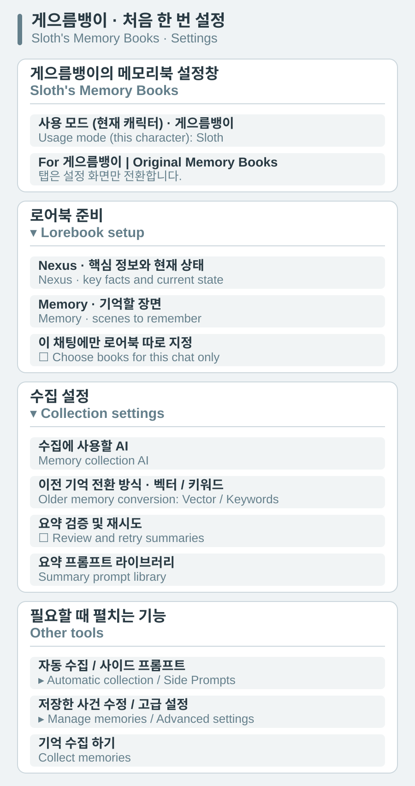
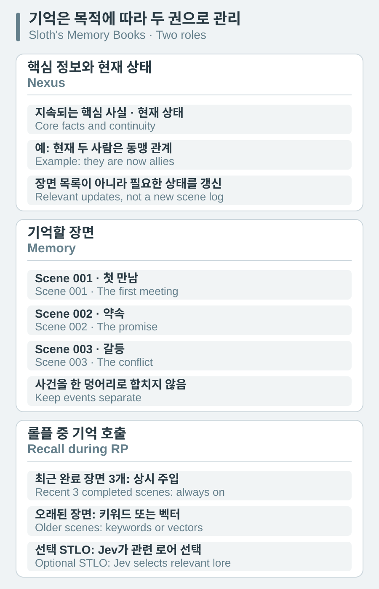

<!--
Copyright (C) 2024–2026 Aiko Hanasaki
SPDX-License-Identifier: AGPL-3.0-only
-->

# 📕 Memory Books

Based on [Memory Books by Aiko Hanasaki](https://github.com/aikohanasaki/SillyTavern-MemoryBooks). This fork integrates my Sloth (게으름뱅이) memory workflow into Memory Books while retaining the original tools in a separate tab. **Usage mode is selected per character; tabs only switch the settings view.**

[한국어 안내 ↓](#-메모리북) · [Original Memory Books](https://github.com/aikohanasaki/SillyTavern-MemoryBooks) · [Original feature guides](./Start_Here.md)

## Start here — Memory Books in five minutes

**Current version: 9.4.0-ambasa.1.** Turn completed RP events into reusable memories. Sloth mode separates Nexus (ongoing continuity) and Memory (completed events). It saves lore; SillyTavern recalls it. The original mode remains available per character; tabs only switch the visible settings.

<p align="center"></p>

**Set up once**

1. Install one Memory Books version only. In a one-to-one chat open Extensions → Memory Books → Usage mode → Sloth (default). Group chats use Original mode.
2. Assign distinct Nexus and Memory books or create them on approved first collection if no books are linked. Use chat-only assignments for different AU histories.
3. Select a collection AI profile, choose Keyword or Vector for older scenes, and leave automatic collection off for your first try. Vector recall requires native vector setup.
**During everyday RP**

4. After a completed event, click Collect memories or /sloth-collect. Confirm the range and approve the event plan. The AI then writes, validates and saves the memories; inspect them in World Info or Lorebook Manager after saving. Optional Hide applies only to successfully saved ranges.
5. Continue RP. The latest three completed scenes stay always-on; older scenes switch recall mode while their text remains saved.

### Works alone, better together

> [!TIP]
> Memory Books works on its own with native keyword/vector recall. Optional STLO selects existing lore with Jev and budgets; WorldInfo Info shows what activated; Lorebook Manager provides a reading library. None is required.

[STLO](https://github.com/AmbasaS2/SillyTavern-LorebookOrdering) · [Lorebook Manager / 로어북 매니저](https://github.com/AmbasaS2/lore-manager) · [WorldInfo Info / 월드인포인포](https://github.com/AmbasaS2/SillyTavern-WorldInfoInfo)

The detailed sections below explain optional settings. Compatibility is version-dependent; it does not guarantee every third-party extension or device.

## Who is this for?

- Preserve individual completed scenes without repeatedly compressing them into a single history summary.
- Separate ongoing continuity and key facts (Nexus) from completed events (Memory).
- Automatically identify completed events from unsaved chat, approve the plan, and optionally hide successfully collected messages.
- Keep the latest three completed scenes always on, convert older scenes to keyword or vector recall, and retain their full text.
- Collect manually or at a token/message interval, use different books for different chats with the same character, and keep the RP model unchanged.
- Generate separate Side Prompts such as diaries; review merge, split, or shortening operations on stored scenes; or select the original Memory Books workflow per character.

If you prefer the original manual or consolidation workflow, select **Original Memory Books** in the character's Usage mode, then use its settings tab. Group chats use Original mode.

## Install and set up once

1. Back up your chats, settings and lorebooks, especially when switching from the original Memory Books.
2. In SillyTavern's extension installer, enter:

   ```
   https://github.com/AmbasaS2/SillyTavern-MemoryBooks
   ```

3. Reload and open an individual character chat. Open **Memory Books** from the extension menu. Check **Usage mode (this character) → For 게으름뱅이 🦥** (default in one-to-one chats), then open the Sloth settings tab. Run only one Memory Books installation at a time.

**The mode selector controls what runs; the two tabs only change the visible settings.** Switching mode keeps existing settings, lorebooks and previously hidden messages. Original workflow operations and automatic collection are mode-gated.

<p align="center"></p>

### 1. Lorebook setup

The Sloth workflow separates two SillyTavern lorebook roles:

<p align="center"></p>

| Book | What goes in it |
|---|---|
| **Nexus** | Key facts, ongoing state and continuity information; core state is kept active, with additional records managed according to their recall settings. |
| **Memory** | Individual completed events, preserved as separate entries instead of repeatedly merging the whole history. |

Choose two distinct books already linked to this character, or confirm your first collection to create and link the two books if the character has no linked books. If only one role is assigned, use the missing-book creation option. Use **Choose books for this chat only** if different chats with the same character need separate histories. Back up and check existing books before assigning their roles; do not assign another character's memories by mistake.

### 2. Collection settings

| Control | How to use it |
|---|---|
| Memory collection AI | Select a saved SillyTavern Chat Completion connection profile or Memory Books AI profile. Your RP model is not switched. |
| Older memory conversion | Choose **Vector** or **Keywords**. On the next collection, older scene entries change to this type; the latest three completed scenes stay always on. Vector mode requires SillyTavern's vector storage to be configured. |
| Review and retry summaries | Optional, off by default. Checks for major omissions or distortions and can make one additional AI request. |
| Summary prompt | Start with the built-in Sloth prompt. View it, copy it to customize the instructions, save named presets or import/export a compatible JSON preset. |

**Start with a collection AI and the default prompt.** You can leave automatic collection off while trying the manual workflow.

## Everyday use: roleplay, then collect memories

<p align="center"></p>

1. Press the collection icon in the chat input row, **Collect memories** in Memory Books, or `/sloth-collect`. Confirm the available message range to start analysis.
2. The collection AI reads the not-yet-collected messages and proposes completed events. Check the suggested ranges and number of memories. Incomplete events can remain for a later collection.
3. Choose whether to hide the successfully saved messages from the AI's active chat context, then approve. The AI writes and saves the scene memories and relevant Nexus updates. Incomplete or unverifiable outputs may be retried or skipped; check the saved memories.
4. Continue your RP. The latest three completed scenes stay active; older ones become keyword or vector entries according to your settings. Their full stored memory text is retained.

Hide is optional and does not delete the chat history. Only successfully saved ranges are eligible to be hidden. You can choose how many recent collected messages to keep visible. Review the proposed ranges and generated memories if exact continuity matters: model judgments can be wrong.

### Approve the plan, then inspect saved memories

The manual plan shows analyzed message ranges, completed event titles and ranges, the Nexus review range, deferred messages and optional Hide. Approving starts AI writing, validation and saving. The current collection workflow does not have a second editable Scene/Nexus draft popup. Read or edit saved entries in World Info or the optional Lorebook Manager afterward. Incomplete scenes can be retried, or completed work can be saved. The optional summary review may make an additional AI request.

<details>
<summary>More on validation, retry and optional tools</summary>

Normal Nexus updates no longer require literal quotation receipts in 9.4.0-ambasa.1; structure, UID, role, duplicate, section and save/rollback safeguards remain. Scene range and legacy reconciliation checks are separate. Hide requires a verified collection receipt. Side Prompt drafts have their own separate review/edit step.

</details>

## Other settings and tools

| Section | When to use it |
|---|---|
| Automatic collection | Turn on **Collect memories automatically** and choose a token or message interval. Default is off; initial interval values are 50,000 tokens / 50 messages. Once enough unsaved content accumulates, collection runs after a reply in eligible chats with both books linked. It does not automatically hide messages. |
| Side Prompts | Choose a prompt in the empty slot and add slots as needed. Built-in examples: Diary, NPC Directory (including minor supporting characters), and Memorable Quotes (verbatim source dialogue). All default to no injection; each can independently use no injection, always-on, vector, or keywords, including custom prompts. Keyword suggestions can be edited before saving. Check the prompts to use for the character and choose a lorebook for each. You can continue an older entry or choose Create lorebook to create the character’s dedicated Side Prompt book on the first approved save (or reuse its existing dedicated book). |
| Manage existing memories | Review merging causally related completed scenes, splitting a completed scene with verifiable original message ranges, or shortening a long event. Choose and inspect changes; preserve original records where archived and back up before editing. |
| Advanced settings | Show or hide the collection icon, place it next to Extensions or Send, choose its size (default 14 px), and choose how many recent collected messages to keep visible when hiding. |
| Original Memory Books | Select Original in Usage mode to run its scene-marker, consolidation and other original workflows. The tab remains available for shared profile/settings tools. |

Memory Books saves memories; it does not itself choose Jev recall during RP. For optional scene-aware lore selection and per-book budgets, see [the STLO fork](https://github.com/AmbasaS2/SillyTavern-LorebookOrdering). To read or edit the resulting lorebooks like a diary, see [the Lorebook Manager fork](https://github.com/AmbasaS2/lore-manager). Both are optional.

Collection, review, and side-prompt generation use AI requests; their cost and results depend on your provider, model, and chat size. Saved memories and chat excerpts may be sent to the selected AI provider. Back up existing data before switching or changing book assignments.

---

# 📕 메모리북

[원본 Memory Books](https://github.com/aikohanasaki/SillyTavern-MemoryBooks)를 기반으로 제가 사용하던 게으름뱅이 메모리북 시스템을 확장 자체에 넣은 포크입니다. 1:1 캐릭터는 기본적으로 게으름뱅이 모드입니다. **사용 모드 (현재 캐릭터)**가 실제 동작을 결정하며 탭은 설정 화면만 바꿉니다. 기존 메모리북을 사용하려면 사용 모드에서 선택하세요.

## 먼저 읽어 보세요 · 처음 사용하는 분을 위한 5분 안내

**현재 버전: 9.4.0-ambasa.1.** 롤플이 길어져도 사건과 지금의 관계를 잊지 않도록 Nexus(핵심 정보와 현재 상태)와 Memory(완료된 사건)를 분리해 저장합니다. 실제 호출은 실리태번이 담당합니다. 원본 모드는 캐릭터별로 선택할 수 있고 탭은 설정 화면만 바꿉니다.

**처음 한 번만 설정하기**

1. 원본과 동시에 켜지 말고 설치합니다. 1:1 채팅 → 확장 메뉴 → Memory Books → 사용 모드에서 For 게으름뱅이(기본값)를 확인합니다. 그룹은 기존 모드입니다.
2. 서로 다른 Nexus·Memory 책을 지정합니다. 연결된 책이 없으면 첫 수집 승인 시 생성할 수 있고 AU마다 채팅별 지정을 쓸 수 있습니다.
3. 수집 AI 프로필과 이전 기억의 키워드/벡터 전환 방식을 고릅니다. 첫 수집은 자동 수집을 끄고 수동으로 해 보세요. 벡터는 ST 자체 설정이 필요합니다.
**평소 롤플할 때**

4. 완료된 사건이 생기면 기억 수집 하기 또는 /sloth-collect → 범위·사건 계획 확인 → 승인 후 AI 작성·검증·저장 → 월드 인포 또는 로어북 매니저에서 저장 결과 확인. Hide는 성공적으로 저장된 구간에만 선택 적용됩니다.
5. 다시 롤플합니다. 최근 완료 Scene 3개는 파란불, 오래된 장면은 조건부 호출로 전환됩니다. 저장된 본문은 유지합니다.

### 단독으로도 충분하고, 함께 쓰면 더 편리합니다

> [!TIP]
> 메모리북 단독으로 기억 수집과 ST 기본 호출을 사용할 수 있습니다. STLO는 선택형 Jev와 예산 관리, 월드인포인포는 발동 확인, 로어북 매니저는 독립 서재를 제공합니다. 모두 선택입니다.

[STLO](https://github.com/AmbasaS2/SillyTavern-LorebookOrdering) · [Lorebook Manager / 로어북 매니저](https://github.com/AmbasaS2/lore-manager) · [WorldInfo Info / 월드인포인포](https://github.com/AmbasaS2/SillyTavern-WorldInfoInfo)

아래에서 필요한 설정만 자세히 읽으세요. 지원 버전 기준이며 모든 기기·다른 확장 조합을 보장하는 것은 아닙니다.

## 이런 분들께 추천합니다!

- 반복 압축·통합으로 과거 사건의 디테일을 잃고 싶지 않은 분
- 핵심 사실·현재 상태(Nexus)와 완료된 사건(Memory)을 두 권으로 분리하고 싶은 분
- AI가 아직 수집하지 않은 대화에서 완료 사건을 골라 주고, 계획을 확인해 승인하고 싶은 분
- 최근 완료 장면 3개는 상시 주입하고 이전 기억은 키워드·벡터로 자동 전환하되 본문을 유지하고 싶은 분
- 메시지 수·토큰 기준 자동 수집 또는 수동 수집을 선택하고, 같은 캐릭터의 여러 채팅에서 별도 기억을 쓰고 싶은 분
- 롤플 모델을 바꾸지 않고 별도 AI·맞춤 프롬프트를 사용하며, 일기 등 사이드 프롬프트를 작성하거나 기존 사건의 합치기·나누기·줄이기를 사용하고 싶은 분
- 기존 메모리북 기능도 캐릭터별로 선택하고 싶은 분

원본의 구간 지정·압축·통합 방식은 사용 모드를 기존 메모리북으로 선택하고 해당 탭을 사용하세요. 그룹 채팅은 기존 메모리북 모드입니다.

## 처음 한 번: 메모리북 설정

1. 기존 채팅·로어북·설정을 백업합니다. 원본과 이 포크를 동시에 실행하지 마세요.
2. 실리태번 확장 설치 메뉴에서 `https://github.com/AmbasaS2/SillyTavern-MemoryBooks`를 설치하고 새로고침합니다.
3. 1:1 캐릭터 채팅 → 확장 메뉴 → **Memory Books** → **사용 모드 (현재 캐릭터) → For 게으름뱅이 🦥**를 확인하고 게으름뱅이 탭을 엽니다.

**모드와 탭은 다릅니다.** 모드를 변경해도 기존 로어북과 설정은 유지되며, 이전에 Hide한 메시지는 자동으로 복원되지 않습니다.

<p align="center"></p>

### 1. 로어북 준비

게으름뱅이 시스템은 로어북을 두 역할로 나눠 사용합니다.

<p align="center"></p>

| 로어북 | 저장하는 내용 |
|---|---|
| **Nexus · 핵심 정보와 현재 상태** | 캐릭터와의 관계, 지속되는 사실, 현재 상태 등 앞으로의 롤플에 필요한 정보. 핵심 상태는 상시로 유지하고 추가 기록은 설정한 호출 방식을 따릅니다. |
| **Memory · 기억할 장면** | 롤플에서 실제로 일어난 사건을 장면별로 저장합니다. 이전 기억을 삭제하거나 모두 한 덩어리로 합치지 않습니다. |

이미 캐릭터에게 연결된 책이 있다면 Nexus와 Memory에 서로 다른 책을 지정합니다. 연결된 책이 없는 새 캐릭터는 첫 수집을 승인할 때 두 권을 생성·연결할 수 있습니다. 한 권만 지정되어 있다면 부족한 책 만들기 기능을 사용하세요.

같은 캐릭터와 여러 채팅에서 서로 다른 이야기를 진행한다면 **이 채팅에만 로어북 따로 지정**을 사용하세요. 다른 채팅의 기본 책은 유지됩니다.

### 2. 수집 설정

| 설정 | 언제, 어떻게 쓰나요? |
|---|---|
| 수집에 사용할 AI | 기억 정리에 사용할 실리태번 채팅 완성 연결 프로필 또는 메모리북 AI 프로필을 선택합니다. RP 모델을 바꾸지 않습니다. |
| 이전 기억 전환 방식 | 벡터 또는 키워드를 선택합니다. 다음 수집 때 오래된 기억을 해당 방식으로 전환하고 최근 기억 3개는 파란불로 유지합니다. 벡터를 쓰려면 실리태번 벡터 저장소를 별도로 설정하세요. |
| 요약 검증 및 재시도 | 큰 누락이나 왜곡을 검사할 때 켭니다. 기본 꺼짐이며 AI 호출이 최대 한 번 추가될 수 있습니다. |
| 사용할 요약 프롬프트 | 기본 게으름뱅이 프롬프트로 시작하세요. 전체 보기, 복사 후 수정, 이름 변경, 저장, 호환 JSON 가져오기·내보내기가 가능합니다. |

처음에는 수집 AI만 정하고 기본 프롬프트로 수동 수집을 한 번 해 보세요.

## 평소 사용법: 롤플하고 사건이 끝나면 수집!

<p align="center"></p>

1. 입력창의 **수집 아이콘**, 메모리북의 **기억 수집 하기** 또는 `/sloth-collect`를 사용합니다. 화면에 표시된 메시지 범위를 확인하면 분석을 시작합니다.
2. AI가 아직 수집하지 않은 메시지를 읽고 완결된 사건을 나눠 제안합니다. 분석 범위와 저장할 기억의 개수를 확인하세요. 진행 중인 사건은 다음 수집에 남길 수 있습니다.
3. **저장한 구간을 AI 대화 맥락에서 숨기기**를 사용할지 선택하고 승인합니다. AI가 사건별 기억을 작성·저장하고 필요한 Nexus 정보를 갱신합니다. 불완전하거나 검증되지 않은 결과는 재시도 또는 제외될 수 있으므로 저장된 내용을 확인하세요.
4. 다시 롤플하면 됩니다. 최근 완료 Scene 3개는 상시로, 오래된 Scene은 선택한 벡터 또는 키워드 방식으로 관리됩니다.

Hide는 채팅 원문 삭제가 아닙니다. 저장된 범위만 AI가 읽는 채팅 맥락에서 숨기며, 수집한 메시지 중 최근 몇 개를 남길지도 지정할 수 있습니다. AI가 사건 범위를 잘못 판단하거나 중요한 내용을 놓칠 수 있으니 필요한 경우 수집 계획과 저장된 내용을 확인하세요.

### 수집 계획 승인과 저장 후 확인

계획창에서 분석 범위, 완료 사건 제목과 대화 범위, Nexus 갱신 범위, 다음에 남길 구간, 숨기기 여부를 확인합니다. 승인하면 AI가 작성·검증·저장을 진행합니다. 현재 일반 수집에는 별도의 최종 Scene/Nexus 본문 편집 팝업이 없습니다. 저장한 항목은 월드 인포 또는 선택적 로어북 매니저에서 확인·수정하세요. 미완료 기억은 재시도하거나 완료된 작업만 저장할 수 있습니다. 선택형 요약 검증은 추가 AI 요청이 발생할 수 있습니다.

<details>
<summary>저장 검증·복구와 사이드 프롬프트 자세히 보기</summary>

9.4.0-ambasa.1부터 일반 Nexus 갱신에 원문 직접 인용이 필수는 아니지만 구조·UID·역할·중복·섹션·저장 및 복구 검증은 유지합니다. 사건 범위 및 기존 기억 이전의 검증은 별개입니다. 수집 기록 검증에 성공한 구간만 숨길 수 있습니다. 사이드 프롬프트 초안은 별도 검토·편집 단계가 있습니다.

</details>

## 나머지 설정은 필요할 때만!

| 설정 영역 | 활용법 |
|---|---|
| 자동 수집 | 기본 꺼짐. 새 미수집 내용이 일정 토큰 또는 채팅 개수만큼 쌓이면 답변 후 자동으로 완결 사건을 수집합니다. 기본 간격은 50,000토큰 / 50개 메시지이며 직접 변경할 수 있습니다. Nexus·Memory가 연결된 채팅에서 작동하며 자동으로 Hide하지 않습니다. |
| 사이드 프롬프트 | 빈 칸에서 기본 예시인 일기·NPC 등장인물록(조연 포함)·명대사 모음(실제 발화 그대로) 또는 사용자 프롬프트를 고릅니다. 기본은 미주입이며 각 프롬프트에서 미주입·상시·벡터·키워드를 독립적으로 선택할 수 있습니다. 키워드는 저장 검토 화면에서 수정할 수 있습니다. 필요한 만큼 칸을 추가하고, 이 캐릭터에서 쓸 프롬프트에 체크한 뒤 각각 저장할 로어북을 고릅니다. 기존 항목에 이어 쓰거나, 로어북 생성하기 [캐릭터 이름-메모리북 사이드 프롬프트]를 선택해 필요한 책을 첫 승인 저장 때 만들 수 있습니다. |
| 저장한 사건 수정 | 인과적으로 연결된 완료 사건 합치기, 원래 메시지 범위와 순서를 확인할 수 있는 사건 나누기, 긴 사건 줄이기를 필요할 때 사용합니다. 자동 통합이 아니라 대상과 변경안을 확인하는 작업이며 기존 기록을 백업합니다. |
| 고급 설정 | 수집 아이콘 표시 여부, 확장 메뉴 옆 또는 전송 버튼 옆 위치, 크기(기본 14px), Hide 시 남길 메시지 수(기본 0)를 설정합니다. |
| 기존 메모리북 | 사용 모드를 기존 메모리북으로 변경해야 원본의 구간 지정·압축·통합 등 작업이 실행됩니다. 탭은 공유 프로필·설정 열람에도 사용할 수 있습니다. |

### 다른 로어북 확장과 함께 사용하고 싶다면

- **[STLO 포크](https://github.com/AmbasaS2/SillyTavern-LorebookOrdering)**: 메모리북의 토큰 예산을 제한하고 상시 기억을 보호하거나, 제브로 현재 장면에 필요한 오래된 기억을 골라 불러올 수 있습니다. 제브 설정은 STLO에 있습니다.
- **[로어북 매니저 포크](https://github.com/AmbasaS2/lore-manager)**: 저장한 Memory를 일기장처럼 찾아 읽고 번역하거나 원문을 수정할 수 있습니다.

둘 다 필수 확장은 아닙니다. 수집·검증·사이드 프롬프트 작성에는 AI 호출이 발생하며 비용과 결과는 사용 모델·채팅 길이에 따라 달라집니다. 수집용 AI 제공자에게 채팅 및 기억 내용이 전달될 수 있다는 점을 고려해 주세요.

---

**Documentation basis / 안내 기준:** main [`8bcf2d0`](https://github.com/AmbasaS2/SillyTavern-MemoryBooks/commit/8bcf2d05529278d4802742e9a19dedceaf6e5717) (2026-11-25), upstream manifest 9.4.0. Illustrations are bilingual UI guides, not live screenshots. Installed SillyTavern and live provider integration are not verified by this documentation update.

## Original Memory Books documentation / 원본 기능 안내

> **Not sure how AI memory actually works?**  
> Read [How Memory Works in SillyTavern](https://www.hanasaki.ai/ref/stmemory.html) for a plain-language explanation of chat history, summaries, lorebooks, vector retrieval, trackers, and where Memory Books fits.

- [Quickstart / 원본 기능 시작하기](./Start_Here.md)
- [Memory Books AI Reference Manual / 원본 AI 참조 매뉴얼](userguides/1%20Memory_Books_AI_Reference_Manual.md) — download and upload to an assistant to ask about the original features.
- [Original source / 원작 저장소](https://github.com/aikohanasaki/SillyTavern-MemoryBooks)

Fork modifications and documentation: AmbasaS2. Thanks to Aiko Hanasaki for the original extension.

## Copyright and License

SillyTavern Memory Books is Copyright © 2024–2026 Aiko Hanasaki.

The original code in this repository is licensed under the GNU Affero General Public License v3.0. Modified versions and forks must preserve applicable copyright and license notices, identify their modifications, and comply with the AGPL's source-availability requirements. 

See [LICENSE](./LICENSE).
