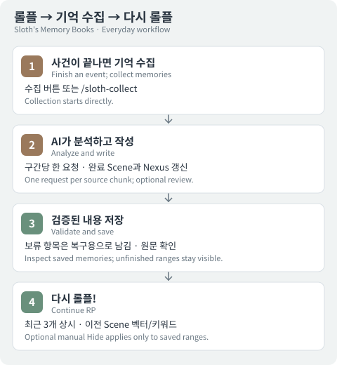
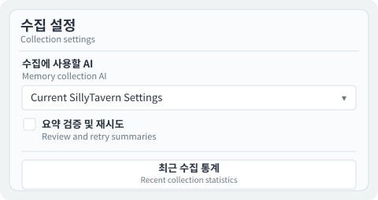
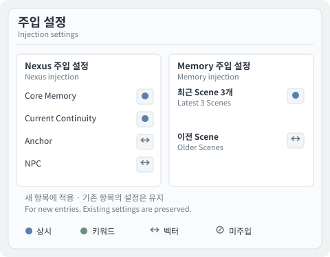
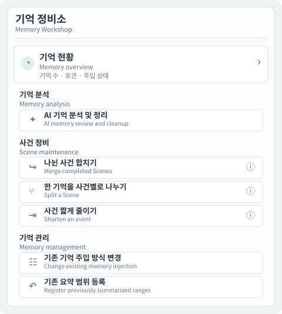
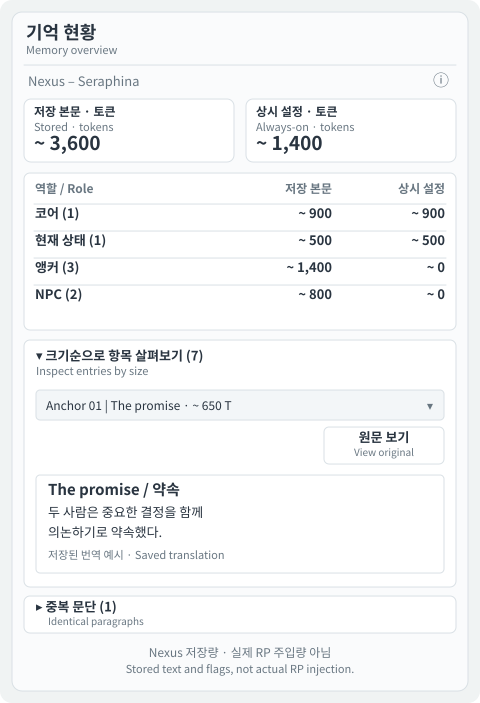
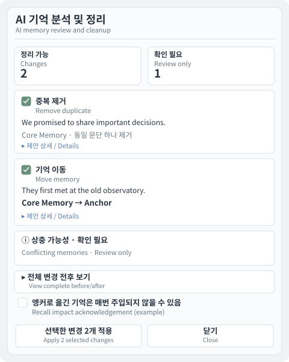
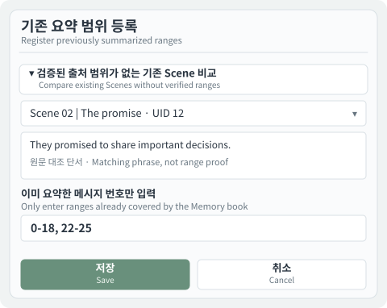
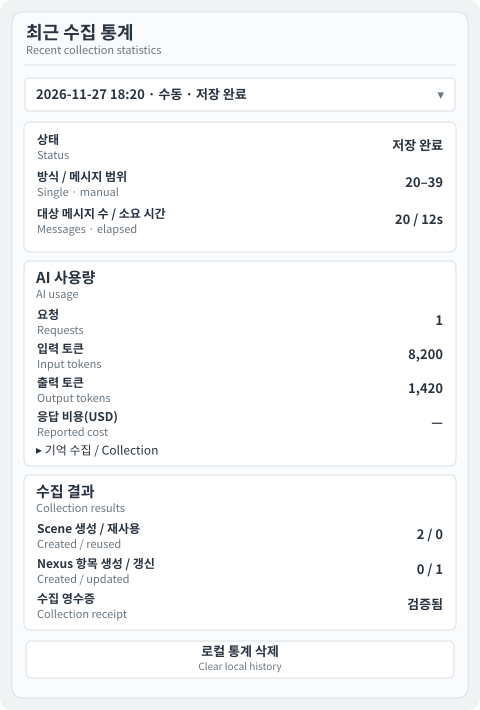

<!--
Copyright (C) 2024–2026 Aiko Hanasaki
SPDX-License-Identifier: AGPL-3.0-only
-->

# 📕 Sloth's Memory Books

Based on [Memory Books by Aiko Hanasaki](https://github.com/aikohanasaki/SillyTavern-MemoryBooks). Save the scenes you love instead of repeatedly compressing your entire history.

[한국어 안내 ↓](#-메모리북) · [Original guide](./Start_Here.md)

## 📥 Installation

```text
https://github.com/AmbasaS2/SillyTavern-MemoryBooks
```

**Install extension → paste the URL → install → reload.**

> Back up chats, lorebooks and settings. Don't run the upstream extension and fork together.

## ⚡ Quick start

**Once:** choose Nexus and Memory → collection AI → older-scene recall mode.

**Everyday:** finish an event → Collect memories → check the result → go back to RP!



## 📖 Set up once

### ① Choose the usage mode

Individual chat → Extensions → Memory Books → **For 게으름뱅이 🦥**.


Switching tabs does not switch usage mode. Group chats use Original Memory Books.

### ② Choose two books


> **🧭 Nexus — Who are we now?** Relationships, key facts, ongoing state and individual lasting memories.
>
> **📕 Memory — How did we get here?** First meeting, argument, reconciliation. Each completed event has its own record.

Assign two different linked books. No books yet? Create them on the first successful collection. One missing? Create the missing book. Use chat-only assignments for different AUs.

<details>
<summary>Already have manual memories?</summary>

Back up first and check linked books. Register verified previously summarized source ranges in Memory Workshop. Old STMB_start/end metadata alone is not a collection receipt or proof of automatic rotation eligibility. Changing books after collecting may require a separate migration.

</details>

### ③ Choose the collection AI

**Collection settings → Memory collection AI.** Use a saved Chat Completion or Memory Books profile. Your RP model stays unchanged.



Review and retry summaries is off by default; it can add one request. Start with the default Sloth summary prompt. The prompt library supports viewing, copying, editing, saving, renaming and compatible JSON import/export.

### ④ Choose how memories return

**Lorebook setup → Injection settings.**



| Nexus role | What it remembers | Default |
| --- | --- | --- |
| Core Memory | Lasting facts and relationships | Always on |
| Current Continuity | Ongoing state | Always on |
| Anchor (legacy LT) | Individual lasting memories | Existing detail mode |
| NPC | Character-specific memories | Existing detail mode |

The detail mode is normally Vector. Each Nexus role can use Always on, Keywords, Vector or No injection.

| Memory | Recall |
| --- | --- |
| Latest 3 eligible completed Scenes | 🔵 Always on |
| Older managed Scenes | Vector or Keywords |

Keep the defaults first. Native Vector Storage is required for vector recall. New Nexus settings apply to new entries; explicitly apply them to eligible existing entries in Workshop. Older managed Scenes rotate during collection. Always-on flags still obey budgets.

## 🎮 Everyday RP — collect after an event!

Tap the collection icon or **Collect memories**, or enter:

```text
/sloth-collect
```

The AI identifies completed events and necessary Nexus changes. Validated results save directly, without a plan approval popup. Unfinished or unverified source remains available. Inspect stored content and edit it in World Info or Lorebook Manager.

> **Hide does not delete chat.** Manual Hide is opt-in in Advanced settings. Only verified saved ranges are hidden; automatic collection does not auto-Hide.

<details>
<summary>How collection works</summary>

One request per source chunk by default, with uncollected source, editable Nexus, character context and recent completed Scene titles/Results. Long chats may be chunked; unsafe input can stop rather than silently truncate. Optional review may add a request. AI can misinterpret details, so inspect important memories. Normal collection has no final body-edit popup.

</details>

## 🪄 Optional settings

**Automatic collection:** off by default. Set 50,000 tokens or 50 messages initially; it runs after replies when both books are linked and the threshold is reached.

**Side Prompts:** choose Diary, NPC Directory, Memorable Quotes (actual original dialogue), or a custom prompt → enable → select destination → choose injection.

<details>
<summary>More about Side Prompts and Advanced settings</summary>

Add slots, continue existing entries or create a dedicated book on first approved save. No injection is default; Always on, Vector and Keywords are optional. Edit suggested keywords during review. Enabled prompts can run as separate follow-ups after manual collection or from Run Side Prompts. Their draft review is separate. Automatic collection does not run these follow-ups.

Collection icon visibility, icon, position and size (default 14 px) are adjustable. Hide after collection is off by default; the default number of recent collected messages to keep visible is 0.

</details>

## 🧰 Memory Workshop — saved memories need attention?

Expand **Memory Workshop** below Advanced settings. No need to leave it open.



### 🔎 Memory overview



Read stored Nexus token estimates, always-on flags, role sizes and identical paragraphs. Select an entry to view Markdown or compatible saved translations.

**Read-only.** These are stored Nexus measurements, not actual RP inclusion.

### 🧹 AI memory review and cleanup



Analyze → select changes → compare before/after → apply.

- Changes: validated exact duplicate removal or verbatim Core-to-Anchor moves.
- Review only: possible conflicts/validity concerns.

> Moving Core text into Anchor may mean it isn't recalled every turn. Explicitly approve only changes you want.

<details>
<summary>Review scope and safeguards</summary>

Explicit consent sends eligible active Nexus entries to the collection AI, not chat history. Protected, disabled and archived entries are excluded. Pending recovery or stale source/settings blocks unsafe writes. AI suggestions are not a semantic guarantee.

</details>

### ✂️ Scene maintenance

Merge related completed events, split a supported Scene, or shorten a selected long event. Review and approve the proposed changes. This is not automatic consolidation.

Back up Memory before editing. Splitting requires supported latest completed Scenes with visible verifiable original ranges/order; source is archived. Hidden or ambiguous legacy records can block it.

### 🗂️ Memory management

Change existing Nexus injection explicitly, confirming eligible/skipped entries. Register previously summarized ranges if you already wrote memories manually.



Enter only ranges covered by the selected Memory book, e.g. `0-18, 22-25`. Matching phrases are clues, not proof of full coverage. Blank clears registration. This does not create memories or certify old Scenes for rotation.

<details>
<summary>Prefer Original Memory Books?</summary>

Select Original in Usage mode. Range selection, Memories, Clips, Topical Clips, Side Prompts, consolidation and compression remain available. See [original guide](./Start_Here.md).

</details>

## 📊 How much AI did collection use?

**Collection settings → Recent collection statistics.**



The latest 30 attempts in this browser: collection/review/attached Side Prompt usage, token/cache/cost reports, elapsed time, Scene/Nexus results and recovery receipts. These are collection statistics, not RP prompt counts.

<details>
<summary>Measurement and recovery</summary>

Reported usage and estimates are separate. Unknown is not zero; cache tokens may overlap input. Clear local history deletes only statistics, not memories or recovery. Statistics store no chat text or credentials.

Valid results may save independently, while rejected changes remain for recovery. If original chat, ranges, books and content still match, collect again to review/reuse a retained response. Targeted evidence checks apply to important Anchor and protected Core/Continuity changes; exact quotation does not guarantee meaning. UID, role, duplicate, section, source, stale-write and save/readback checks remain. The two books are not a single atomic transaction; keep backups.

</details>

## 🧩 Works well with

- [STLO](https://github.com/AmbasaS2/SillyTavern-LorebookOrdering): optional Jev recall and book budgets.
- [WorldInfo Info](https://github.com/AmbasaS2/SillyTavern-WorldInfoInfo): verified insertion and Lore Insight.
- [Lorebook Manager](https://github.com/AmbasaS2/lore-manager): read saved memories and translations.

**[Illustrated four-extension guide](docs/four-extensions-guide.md).** Each extension works independently.

> Collection, review, Side Prompts and AI maintenance may send chat/lore to the selected provider. Costs and results vary. Overview, statistics and stored translation reading make no extra AI requests.

Illustrations are UI-based examples, not live screenshots. Theme and window size may differ.


---

<a id="-메모리북"></a>

# 📕 게으름뱅이의 메모리북

> **게으름뱅이의 메모리북 설치하기**
>
> [GitHub 다운로드](https://github.com/AmbasaS2/SillyTavern-MemoryBooks)
>
> ```txt
> https://github.com/AmbasaS2/SillyTavern-MemoryBooks
> ```
>
> 실리태번 **확장 설치 → 주소 붙여넣기 → 설치 → 새로고침**
>
> 원본과 동시에 켜지 마세요! 기존 채팅·로어북·설정은 먼저 백업해 주세요.

## 이 확장, 누가 쓰면 좋을까? ✍️(◔◡◔)

- 🧠 어제 있었던 일을 캐릭터보다 내가 더 잘 기억해서 슬픈 사람
- 🦥 사건마다 구간 지정하고 요약하고 저장하기는 너무 귀찮은 사람
- 📕 기억을 자꾸 합치고 압축하다 중요한 디테일이 없어지는 게 싫은 사람
- 🧭 지금의 관계와 지나간 사건을 따로 정리하고 싶은 사람
- 📔 내 캐릭터의 일기나 명대사 모음도 읽고 싶은 사람
- 🧹 저장한 기억이 너무 많아져서 중복·오류를 정리하고 싶은 사람

## ⚡ 간단 사용 설명

> **처음 한 번**
>
> Nexus·Memory 두 권 지정 → 수집 AI 선택 → 오래된 기억의 호출 방식 선택.
>
> **평소에는**
>
> 롤플 → 사건이 끝나면 기억 수집 → 저장 확인 → 다시 놀기!


**오래된 사건을 자꾸 압축하는 대신 호출 방식만 바꿉니다.**  
지금 필요한 기억은 실리태번 기본 기능이나 선택형 STLO Jev로 불러오면 돼요.

## 📖 사용 설명서

## ① 처음 한 번, 기억을 저장할 준비

**1. 사용할 모드 선택**

> 1:1 캐릭터 채팅 → 확장 메뉴 → 메모리 북 → **사용 모드 (현재 캐릭터) → For 게으름뱅이**


- For 게으름뱅이: 사건별 기억 수집 (1:1 기본값)
- 기존 메모리북: 원본 구간 지정·압축·통합 방식

**탭을 바꾸는 것과 모드를 바꾸는 것은 달라요!** 그룹 채팅은 기존 메모리북 모드를 사용합니다.

---

**2. 기억을 저장할 두 권 고르기**


> **🧭 Nexus = 지금 우리는 어떤 사이인가?**
>
> 두 사람의 관계, 핵심 사실, 현재 상태, 장기 기억, NPC.

> **📕 Memory = 우리가 여기까지 어떻게 왔는가?**
>
> 처음 만난 날, 다퉜던 날, 화해했던 날… 끝난 사건을 각각 저장.

오늘 화해했다고 어제 싸운 일이 없어지는 건 아니잖아요? 현재 관계는 바뀌어도 그때의 사건은 그대로 남겨 두는 방식이에요.

> - 연결된 서로 다른 두 권을 지정합니다. 책 이름은 자유!
> - 책이 없다면 첫 수집 저장 시 만들 수 있습니다.
> - 한 권만 있다면 부족한 책 만들기.
> - 여러 AU라면 이 채팅에만 로어북 따로 지정.

<details>
<summary>💡 이미 열심히 정리해 둔 로어북이 있다면?</summary>

원본을 백업하고 현재 채팅·캐릭터의 연결된 책인지 먼저 확인하세요. 기억 정비소의 기존 요약 범위 등록으로 이미 보존된 원문 범위를 등록할 수 있습니다. 구형 STMB\_start/end 정보만으로 수집 완료나 최근 Scene 회전이 보장되지는 않아요. 이미 수집한 채팅의 책 변경에는 별도 이전 검토가 필요할 수 있습니다.

</details>

---

**3. 수집에 사용할 AI 정하기**

> 수집 설정 → **수집에 사용할 AI** 선택
>
> 실리태번 채팅 완성 연결 프로필 또는 메모리북 AI 프로필. 평소 롤플 모델은 그대로입니다.


- 요약 검증 및 재시도: 기본 꺼짐. 큰 누락·왜곡을 점검하며 AI 요청이 최대 한 번 더 발생할 수 있어요.
- 요약 프롬프트: 처음엔 기본 게으름뱅이 프롬프트로 시작하세요.

<details>
<summary>✍️ 프롬프트 라이브러리 (선택)</summary>

전체 보기 / 복제 / 수정 / 저장 / 이름 변경 / 호환 JSON 가져오기·내보내기

</details>

---

**4. 기억을 어떻게 불러올까요?**

> 로어북 준비 → **주입 설정** 펼치기


> **Nexus의 네 가지 기억**
>
> **Core Memory (코어)** 🔵  
언제나 알아야 할 핵심 사실과 관계. 기본 상시.
>
> **Current Continuity (현재 상태)** 🔵  
지금 상황과 아직 이어지는 일. 기본 상시.
>
> **Anchor (앵커, 기존 LT)**  
필요할 때 다시 꺼내 읽을 개별 장기 기억.
>
> **NPC**  
인물별 기억.
>
> 앵커·NPC는 기존 상세 호출 방식(보통 벡터)이 기본입니다. 각 역할은 상시·벡터·키워드·미주입을 고를 수 있어요.

> **Memory의 두 가지 기억**
>
> 🔵 최근 완료 Scene 3개 — 상시
>
> 🟢 그 이전 Scene — 키워드 또는 벡터
>
> 오래되어도 본문은 그대로! 최근 3개보다 적게 있다면 있는 만큼 상시로 관리합니다.

> 기본값으로 시작하셔도 됩니다. 벡터를 쓰려면 실리태번 벡터 저장소를 먼저 설정해 주세요.
>
> Nexus 주입 설정은 새 항목부터 적용합니다. 기존 항목까지 바꾸려면 ④ 기억 정비소를 이용하세요. 관리되는 이전 Scene은 다음 수집 때 호출 방식이 갱신됩니다. 상시 설정도 실제 주입 예산은 적용돼요.

---

## ② 롤플하다 사건이 끝나면 기억 수집!

> 입력창의 수집 아이콘 또는 설정 하단의 **기억 수집** 버튼.
>
> 채팅 명령어로도 가능합니다.
>
> ```txt
> /sloth-collect
> ```

**누르면 알아서 수집합니다.** 매번 요약할 범위를 고르거나 계획을 승인하실 필요 없어요.

- AI가 완료 사건을 찾아 Memory에 저장.
- 필요한 Nexus 정보도 함께 갱신.
- 진행 중이거나 검증되지 않은 사건은 다음 수집 또는 복구에 남김.

저장한 본문과 키워드는 월드 인포 또는 로어북 매니저에서 확인하세요. 마음에 안 드는 내용은 저장 후 수정할 수 있어요.

> **숨기기는 삭제가 아닙니다!**
>
> 고급 설정 → 저장한 구간을 /hide 처리하기 (기본 꺼짐).
>
> 수동 수집에서 검증·저장에 성공한 구간만 숨깁니다. 자동 수집은 자동으로 숨기지 않아요. 이미 숨긴 메시지는 모드를 변경해도 자동 복원되지 않습니다.

<details>
<summary>💡 수집이 어떻게 진행되나요?</summary>

기본 수집은 구간당 한 AI 요청으로 미수집 원문·수정 가능한 Nexus·캐릭터 정보·최근 완료 Scene 제목과 Result를 참고합니다. 긴 대화는 구간을 나눌 수 있습니다. 선택 검증이 요청을 추가할 수 있고, 안전하게 처리하기 어려운 입력을 몰래 잘라내는 대신 중단할 수 있어요. 일반 수집에는 계획 승인이나 최종 본문 편집 팝업이 없습니다. AI가 사건 경계나 정보를 잘못 판단할 수 있으니 중요한 기억은 확인하세요.

</details>

## ③ 매번 누르기도 귀찮다면? (선택)

> **⏰ 자동 수집**
>
> 자동 수집 켜기 → 토큰 또는 메시지 간격 선택
>
> - 기본 꺼짐
> - 토큰 초기값 50,000
> - 메시지 초기값 50개
>
> 두 기억 책이 연결된 채팅에서 설정량이 쌓이면 답변이 끝난 후 완료 사건을 수집합니다. 첫 수집 결과가 마음에 들 때 켜 주세요.

> **📔 사이드 프롬프트**
>
> 기억 외에도 따로 기록하고 싶은 게 있나요?
>
> - Diary: 캐릭터 일기
> - NPC Directory: 주변 조연 인물록
> - Memorable Quotes: 실제 발화 명대사 모음 (원문 필요)
>
> 빈 칸에서 프롬프트 선택 → 사용할 항목 체크 → 저장할 책 지정 → 주입 방식 선택.

<details>
<summary>💡 사이드 프롬프트 설정 자세히</summary>

필요한 만큼 슬롯을 추가하고 사용자 프롬프트도 선택할 수 있습니다. 기존 항목에 이어 쓰거나 첫 승인 저장 때 전용 책을 만들 수 있어요. 미주입이 기본이며 상시·벡터·키워드도 선택 가능합니다. 키워드는 저장 전 검토 화면에서 수정하세요.

수동 수집에서 Scene 저장 후 활성 사이드 프롬프트를 후속 실행하거나 사이드 프롬프트 실행 버튼으로 따로 실행합니다. 초안 검토·편집·승인은 별개이고 자동 수집은 후속 사이드 프롬프트를 실행하지 않습니다.

</details>

> **🎛️ 고급 설정**
>
> 수집 아이콘 표시 여부 / 모양 / 위치 / 크기(기본 14px).
>
> 저장한 구간을 /hide 처리하기(기본 꺼짐), 숨길 때 남겨 둘 수집 메시지 수(기본 0).

---

## ④ 기억 정비소 — 저장한 기억이 마음에 안 든다면?

**고급 설정 아래 → 기억 정비소**를 펼치세요. 평소에 열어 둘 필요는 없습니다!


### 🔎 기억 현황

Nexus가 너무 뚱뚱해졌나 싶을 때.


> - 저장된 본문 토큰 / 상시 설정 토큰
> - 역할별 기억 수와 분량
> - 크기순 항목 및 동일 문단
> - 제목을 골라 현재 본문 열람. 호환 저장 번역이 있으면 원문·번역 전환!
>
> **읽기 전용**이라 기억을 알아서 바꾸거나 지우지 않습니다. Nexus의 저장량이지 이번 RP 주입량은 아니에요.

### 🧹 AI 기억 분석 및 정리

기억이 중복되었거나 예전 설정이 지금과 충돌하는 것 같다면?


> AI 기억 분석 및 정리 → 검토할 제안 선택 → 전체 변경 전후 보기 → **선택한 변경 적용**
>
> **정리 가능:** 검증된 동일 문단 제거 / Core → Anchor 원문 문단 이동
>
> **확인 필요:** 상충 가능성·유효성 문제 등 직접 검토할 안내

> AI가 멋대로 기억을 다시 쓰는 기능은 아닙니다. 원하는 변경만 승인하세요! Anchor로 옮기면 매번 주입되지 않을 수도 있어요.

<details>
<summary>💡 분석에 어떤 정보가 쓰이나요?</summary>

명시적으로 승인할 때 적격 활성 Nexus 기억을 수집용 AI에 전달합니다. 채팅 원문은 보내지 않으며 보호·비활성·아카이브 항목은 제외합니다. 보류 복구나 원본·대상·설정 변경이 있으면 안전하지 않은 저장을 막습니다. AI 판단의 의미 정확성은 직접 확인해 주세요.

</details>

### ✂️ 사건 정비

> **나뉜 사건 합치기**  
이어지는 완료 사건을 한 기억으로.
>
> **한 기억을 사건별로 나누기**  
한 기억에 서로 다른 사건이 들어갔다면 분리.
>
> **사건 짧게 줄이기**  
유독 긴 기억의 보존할 내용을 골라 정리.
>
> 계속 압축하는 기능이 아닙니다! 필요한 사건만 선택 → 변경안 확인 → 승인.

<details>
<summary>💡 사건 정비 전 확인</summary>

수정 전 Memory를 백업하세요. 나누기는 원문 메시지 범위와 순서를 검증할 수 있는 지원 대상 최신 완료 Scene에 한해 진행하며 기존 기억을 아카이브에 보존합니다. 숨긴 원문·복합적인 구형 기록 등은 제한될 수 있어요.

</details>

### 🗂️ 기억 관리

> **기존 기억 주입 방식 변경**
>
> Nexus 주입 설정을 기존 적격 항목에도 적용하고 싶을 때. 변경·건너뛸 항목 수를 확인한 후 승인하세요. 키워드가 없거나 복합 역할인 항목은 제외될 수 있습니다.

**기존 요약 범위 등록**

예전부터 직접 요약해 온 분은 여기를 확인하세요!


> 현재 Memory에 이미 보존한 원문 메시지 번호만 입력.
>
> 예: `0-18, 22-25`
>
> 일치하는 원문 구절은 참고용 단서입니다. 실제로 저장한 범위만 등록하세요. 빈 칸으로 등록 범위를 지울 수 있습니다.

새 기억을 만드는 기능도, 기존 Scene을 자동 회전 대상으로 인증하는 기능도 아니에요.

<details>
<summary>📕 기존 메모리북을 쓰고 싶다면?</summary>

사용 모드를 기존 메모리북으로 바꾸면 원본 구간 지정·일반 기억·클립·주제별 클립·사이드 프롬프트·통합·압축을 쓸 수 있습니다. 탭만 바꾸는 것과 모드 변경은 다릅니다. 그룹 채팅은 기존 모드를 사용합니다.

[원본 기능 전체 사용설명서](https://github.com/AmbasaS2/SillyTavern-MemoryBooks/blob/main/Start_Here.md)

</details>

---

## ⑤ 이번 수집에 AI를 얼마나 썼지? (궁금한 분만)

> 수집 설정 → **최근 수집 통계**


- 기억 수집 / 요약 검증 / 사이드 프롬프트 요청
- 공급자 보고 입력·출력·캐시 토큰 / 비용 / 소요 시간
- Scene·Nexus 저장 결과와 수집·복구 기록

현재 브라우저의 최근 30개 수집 시도를 확인할 수 있습니다. 이 숫자는 기억을 저장할 때 쓴 AI 사용량이지 RP에 들어간 토큰이 아니에요.

<details>
<summary>💡 통계와 저장 복구에 관해</summary>

보고값·추정값은 별개이며 미계측은 0이 아닙니다. 캐시 토큰을 중복 합산하지 않아요. 로컬 통계 삭제는 이 브라우저의 통계만 지우며 기억·설정·복구 기록은 유지됩니다. 통계에는 채팅 본문·인증정보를 저장하지 않습니다.

정상 결과는 검증 후 저장하고 보류분은 복구용으로 남길 수 있습니다. 수동 수집을 다시 눌러 원래 채팅·범위·책·내용이 맞으면 기존 응답을 검토·재사용할 수 있어요. 일상 Nexus 갱신은 원문을 근거로 하며 중요한 Anchor 변경이나 보호 대상 Core/Continuity 변경에는 출처 검증을 적용합니다. 정확한 원문 인용도 의미 정확성을 보장하지는 않습니다.

UID·책 역할·중복·섹션·원문 범위·동시 수정·저장 확인 및 복구 검증은 유지됩니다. 두 책이 완전히 동시에 저장되거나 하나가 실패하면 둘 다 취소되는 원자적 트랜잭션은 아닙니다. 별도 백업을 권장합니다.

</details>

## 🧩 함께 쓰면 좋은 확장

> [게으름뱅이를 위한 로어북 예산 관리기 (Lorebook Ordering for Sloths)](https://github.com/AmbasaS2/SillyTavern-LorebookOrdering) 🔮
>
> **메모리북과 어떤 호환?**  
메모리북은 기억을 저장하고 STLO는 저장된 기억의 호출·예산을 관리합니다. Jev를 쓰면 오래된 기억을 지금 장면에 맞춰 골라 줄 수도 있어요.

> [게으름뱅이가 읽는 월드인포인포 (WorldInfo Info of Sloth)](https://github.com/AmbasaS2/SillyTavern-WorldInfoInfo)
>
> **메모리북과 어떤 호환?**  
저장한 기억이 이번 RP에 진짜 들어갔는지 책 버튼으로 확인합니다. 토큰과 확인된 제외 이유는 로어 인사이트!

> [로어북 매니저: 게으름뱅이 (Sloth the Lorebook Manager)](https://github.com/AmbasaS2/lore-manager)
>
> **메모리북과 어떤 호환?**  
Nexus는 카드파일·인물록, Memory는 타임라인·연속 기록장·페이지 넘김으로 예쁘게 읽어 보세요. 기억 현황에서도 호환 저장 번역을 읽을 수 있습니다.

> [실리태번 로어북 4종 연동 사용설명서](https://github.com/AmbasaS2/SillyTavern-MemoryBooks/blob/main/docs/four-extensions-guide.md#한국어-안내)
>
> 네 개를 전부 설치할 필요는 없습니다. 메모리북 단독으로도 기본 기억 호출을 사용할 수 있어요!

> **비용과 데이터**
>
> 수집·검증·사이드 프롬프트·AI 기억 분석 및 사건 정비는 AI 요청을 사용할 수 있습니다. 제공자에게 대화·로어가 전달될 수 있고 비용과 결과는 설정에 따라 달라요. 기억 현황·통계·기존 번역 열람은 새 AI 요청이 없습니다.

#### 📋 원작 및 라이선스

[원작 저장소](https://github.com/aikohanasaki/SillyTavern-MemoryBooks) · [원본 시작 안내](https://github.com/AmbasaS2/SillyTavern-MemoryBooks/blob/main/Start_Here.md) · [실리태번 기억 방식 설명](https://www.hanasaki.ai/ref/stmemory.html) · [AGPL-3.0 라이선스](https://github.com/AmbasaS2/SillyTavern-MemoryBooks/blob/main/LICENSE)

안내 기준: 9.4.0-ambasa.7. 그림은 실제 UI 구조에 기반한 예시 목업이며 테마에 따라 달라질 수 있습니다. [GitHub 한영 README](https://github.com/AmbasaS2/SillyTavern-MemoryBooks)

---

<details>
<summary>Documentation basis / 검증 이력</summary>

**Documentation basis / 안내 기준:** User-facing UI reviewed against [d6c87d1](https://github.com/AmbasaS2/SillyTavern-MemoryBooks/commit/d6c87d1a0cbbdbc14ffcfda9d9e391cefd344687) (9.4.0-ambasa.7, including the subsequent setup layout polish). Prompt text is not revised in this documentation update. Earlier verified runtime [PR #19 / `204d0db`](https://github.com/AmbasaS2/SillyTavern-MemoryBooks/commit/204d0dbe762aaafef62dcd92d7a1b9965568c566), merged to main on 2026-11-27. Node 657/657 and Bun build; isolated SillyTavern 1.19.1 Chrome host verification of revised UI, role compatibility and storage safeguards. UI-only follow-up [PR #21](https://github.com/AmbasaS2/SillyTavern-MemoryBooks/pull/21) passed 658 Node tests, a Bun build and isolated Chrome layout checks (390/1280px, Korean/English). Follow-up [PR #22](https://github.com/AmbasaS2/SillyTavern-MemoryBooks/pull/22) passed 662 Node tests, a Bun build and four isolated Chrome layout checks. Translation lookup compatibility was tested with synthetic records; live installed-device data and latency were not measured. Actual AI accuracy and installed-device behavior vary.

</details>

## Original Memory Books documentation / 원본 기능 안내

> **Not sure how AI memory actually works?**  
> Read [How Memory Works in SillyTavern](https://www.hanasaki.ai/ref/stmemory.html) for a plain-language explanation of chat history, summaries, lorebooks, vector retrieval, trackers, and where Memory Books fits.

- [Quickstart / 원본 기능 시작하기](./Start_Here.md)
- [Memory Books AI Reference Manual / 원본 AI 참조 매뉴얼](userguides/1%20Memory_Books_AI_Reference_Manual.md) — download and upload to an assistant to ask about the original features.
- [Original source / 원작 저장소](https://github.com/aikohanasaki/SillyTavern-MemoryBooks)

Fork modifications and documentation: AmbasaS2. Thanks to Aiko Hanasaki for the original extension.

## Copyright and License

SillyTavern Memory Books is Copyright © 2024–2026 Aiko Hanasaki.

The original code in this repository is licensed under the GNU Affero General Public License v3.0. Modified versions and forks must preserve applicable copyright and license notices, identify their modifications, and comply with the AGPL's source-availability requirements. 

See [LICENSE](./LICENSE).
